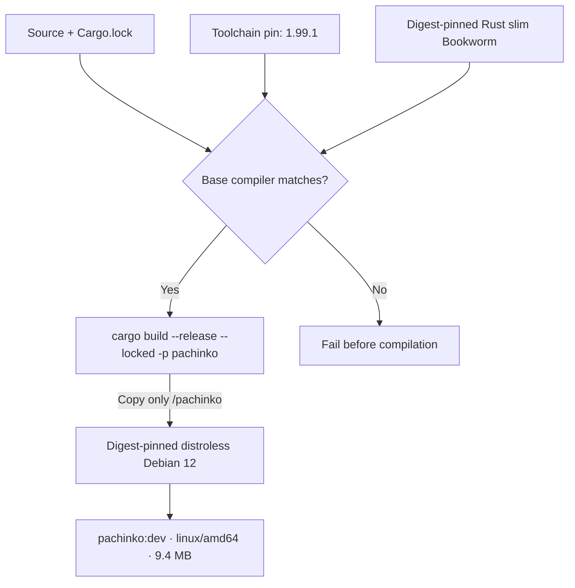
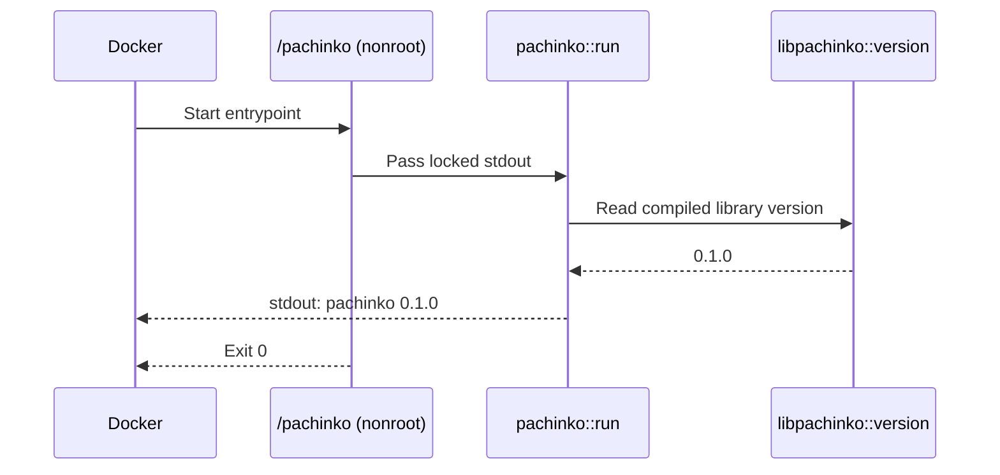
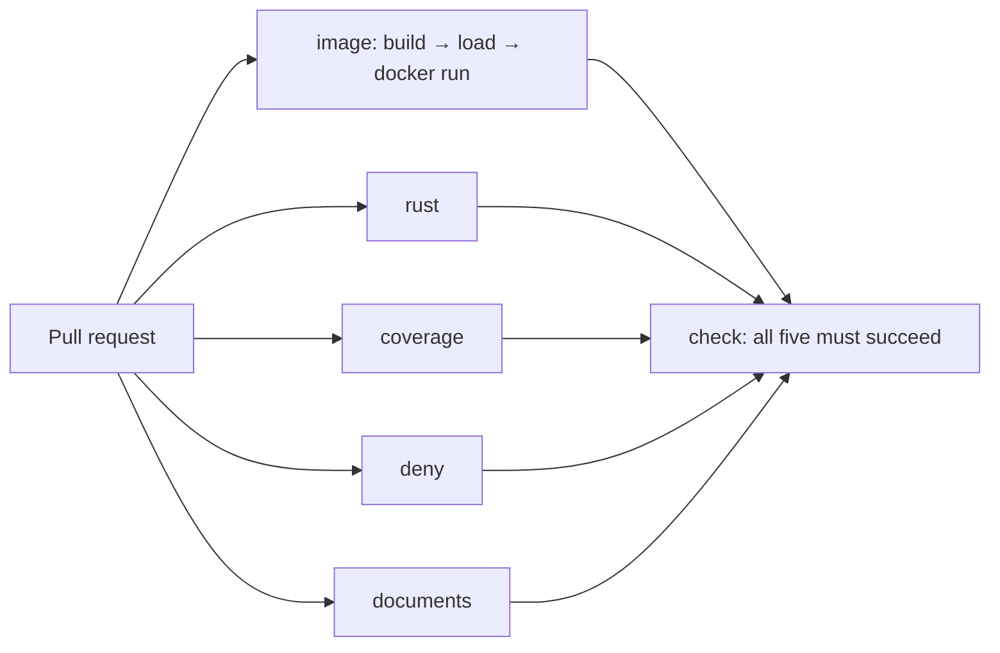

[T13 ticket](https://github.com/BiscuitBin/pachinko/blob/ticket/t13-container-image/tickets/T13-container-image.md) | [Build and run](https://github.com/BiscuitBin/pachinko/blob/ticket/t13-container-image/docs/how-to/build-the-container-image.md) | [Decision 0015](https://github.com/BiscuitBin/pachinko/blob/ticket/t13-container-image/docs/decisions/0015-container-image.md)

## Why the change

Package the existing service as a small container and prove in required CI that it builds and runs before a deployment runtime is chosen.

## Special things to note

- Targets `linux/amd64`; other host architectures need emulation. Both bases use immutable digests, and the runtime runs as `nonroot:nonroot` with no shell or compiler.
- The Rust base must match `rust-toolchain.toml`; a mismatch fails before compilation. Move the Rust image tag, digest and toolchain pins together.
- CI builds, loads and runs the image without publishing it; Docker stays outside `just check`. Ports, health checks and a long-running service await future specifications.

## Change outline

The build stage produces one binary; only that binary crosses into the runtime stage.

Starting the image runs the existing service directly and exits after writing its version.

The image becomes a required CI job alongside the existing source checks.

Observed locally on the T13 implementation:

| Check | Observed result |
| --- | --- |
| `just image` | Builds `pachinko:dev` successfully |
| `docker run --rm pachinko:dev` | Prints `pachinko 0.1.0`; exits 0 |
| Image configuration | `nonroot:nonroot`, entrypoint `/pachinko`, amd64 |
| Runtime image size | 9,359,369 bytes (about 9.4 MB) |
| Scratch toolchain pin bumped to 1.99.2 | Build fails before compilation against base compiler 1.99.1 |
| `just check` | All checks passed; worktree unchanged |

The [first CI run](https://github.com/BiscuitBin/pachinko/actions/runs/40065797710) passed all jobs, including `image` and required `check`, on PR merge commit `47df0d7d3202f78c176ec7a66605be1aa8374bff` (source commit `d47e74c`). The [image job](https://github.com/BiscuitBin/pachinko/actions/runs/40065797710/job/120788668006) printed `pachinko 0.1.0` and exited successfully. Independent conformance and breakage reviews are recorded in the ticket; the valid documentation finding was fixed.
