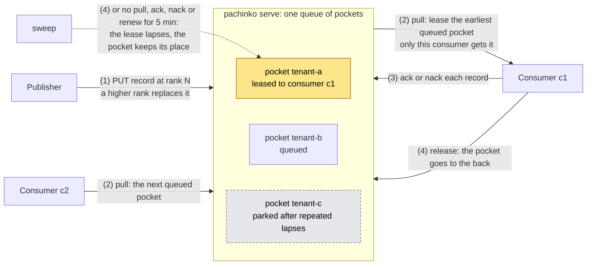

# pachinko

[](https://github.com/BiscuitBin/pachinko/actions/workflows/ci.yml)

A small work queue, written in Rust and served over HTTP/JSON, that hands each consumer
an exclusive lease on one *pocket* of records at a time, and lets a higher-ranked version
of a record replace the one still waiting.

**Status: early, pre-1.0.** Publishers publish keyed, ranked records into pockets; a
higher rank supersedes the waiting record in place. A consumer pulls under a lease on one
pocket, then acks, nacks, renews or releases. A lease left alone lapses, its pocket keeps
its place in the queue, and repeated lapses park the pocket until a publish into it is accepted.
Superseded records and dead letters are kept for 12 hours by default, then decay. It does
not persist anything yet: the queue lives in memory and a restart loses it. It has no
authentication or TLS and listens on `127.0.0.1:8080` by default. One deployment is one
queue. Superseded records and dead letters cannot be read back; who reads them is an open
question. Neither crate is published to crates.io.

## How it works

A consumer with no lease claims the earliest queued pocket; while it holds the lease,
its pulls take more records from that pocket alone.



A pocket left with no records goes idle instead, until a publish into it. Expiry runs on
a sweep, so a late action the service applies before the lapse is not refused for being
late; its other checks still apply
([decision 0019](docs/decisions/0019-service-runtime-tokio-and-http.md)). A newer version
published while its record is held is kept: the ack answers `deferred`, and the newer
version is delivered after the lease ends. The [HTTP API](docs/reference/http-api.md)
has every route and reply, and the specification,
[`docs/specs/pachinko.allium`](docs/specs/pachinko.allium), decides the behaviour.

## Run it

```console
$ cargo run -p pachinko --locked -- serve
listening on 127.0.0.1:8080
$ curl -s -o /dev/null -w '%{http_code}\n' -X POST http://127.0.0.1:8080/publishers/p1
201
$ curl -s -o /dev/null -w '%{http_code}\n' -X POST http://127.0.0.1:8080/consumers/c1
201
$ curl -s -X PUT http://127.0.0.1:8080/pockets/tenant-a/records/k1 \
    -H 'content-type: application/json' \
    -d '{"publisher_id": "p1", "rank": 1, "payload": "aGVsbG8="}'
{"outcome":"created"}
$ curl -s -X POST http://127.0.0.1:8080/consumers/c1/pull \
    -H 'content-type: application/json' -d '{"limit": 10}'
{"outcome":"batch","lease_id":"d8fb1ffb1bd779af0000000000000001","pocket_key":"tenant-a","expires_at":1794468160610,"records":[{"record_key":"k1","rank":1,"payload":"aGVsbG8="}]}
```

Run the curl calls from a second terminal; if port 8080 is taken, `--listen 127.0.0.1:0`
picks a free port and prints it. [Test and debug](docs/how-to/test-and-debug.md#run-the-service)
adds the lease read and the health check, and
[Build the container image](docs/how-to/build-the-container-image.md) packages the service.

## Using pachinko

- [HTTP API](docs/reference/http-api.md): every route, reply and error code, acks included.
- [Configuration](docs/reference/configuration.md): the flags `serve` takes and their defaults.
- [Security model](docs/explanation/security-model.md): what an unauthenticated service exposes.
- [The Rust library](crates/libpachinko/README.md): `libpachinko`, the queue without the
  server, with its [API reference](https://biscuitbin.github.io/pachinko/).
- [The specification](docs/specs/pachinko.allium): the behaviour, and its open questions.
- [Decision 0019](docs/decisions/0019-service-runtime-tokio-and-http.md): why tokio, one owner task and HTTP/JSON.
- [The handbook](docs/README.md): development, architecture and operations.

## Contributing

Follow [Develop locally](docs/how-to/develop-locally.md) for the prerequisites, then run
`just initialize`, which needs the network, and `just check`, which is read-only. Read
[AGENTS.md](AGENTS.md) before changing anything; work is planned as tickets under
`tickets/`, each on its own branch and worktree. [CHANGELOG.md](CHANGELOG.md) records
changes, and [SECURITY.md](SECURITY.md) says how to report a vulnerability privately.

## Licence

Both crates are licensed under Apache-2.0. See [LICENSE](LICENSE).
