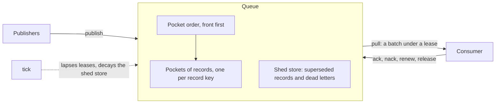
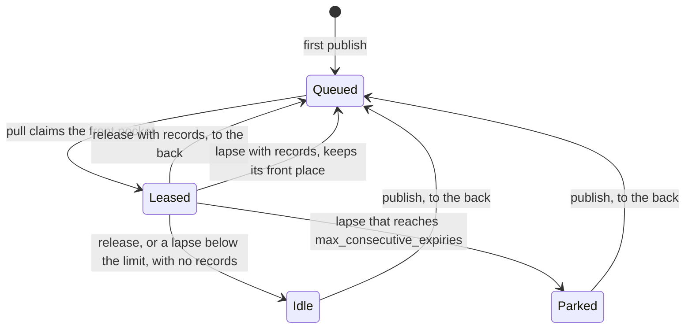
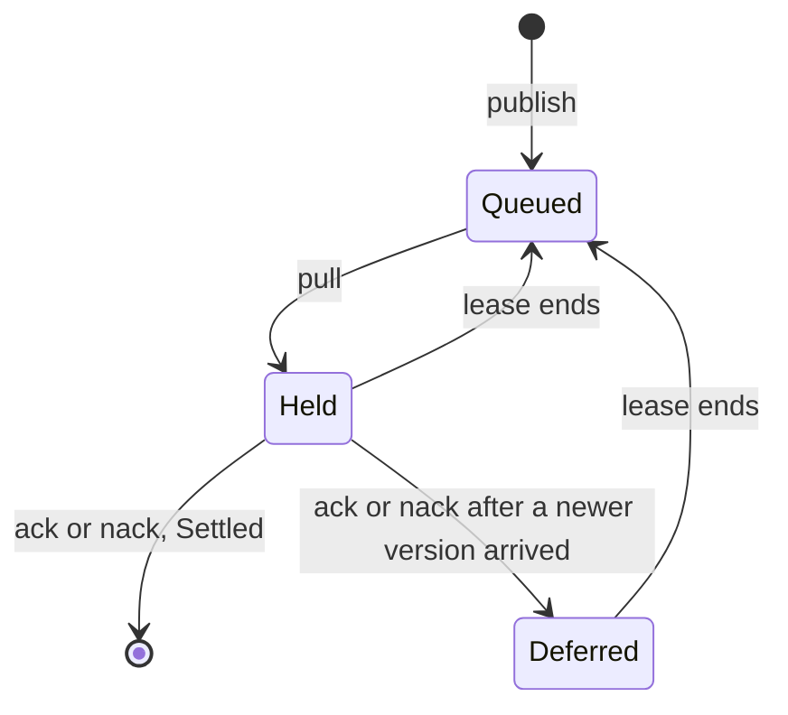
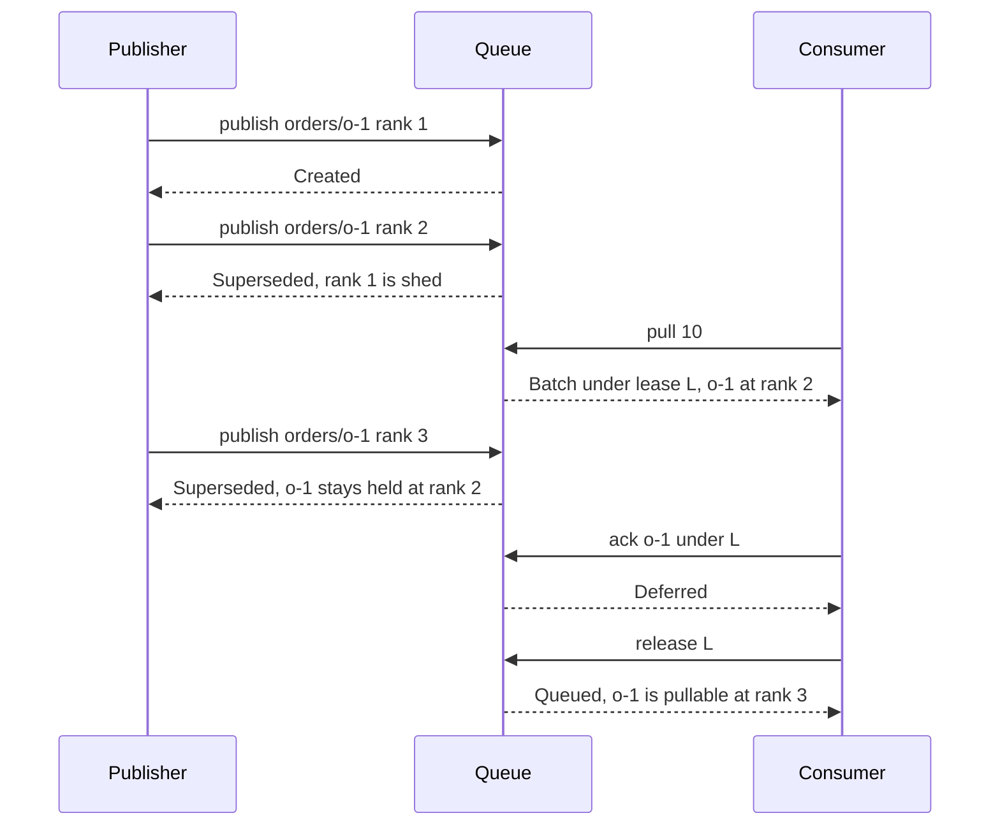

# libpachinko

One queue of pockets: publishers publish keyed records with a rank into pockets, and
a consumer leases one pocket at a time and pulls its oldest records. The library
performs no effect; `docs/specs/pachinko.allium` defines the behaviour.

## Shape



## API

```rust
impl<R: PocketRecords, C: Clock, L: LeaseIds> Queue<R, C, L> {
    fn new(config: Config, clock: C, lease_ids: L) -> Result<Self, ConfigError>;
    fn publisher_joins(&mut self, publisher_id: PublisherId) -> Result<(), JoinError>;
    fn consumer_joins(&mut self, consumer_id: ConsumerId) -> Result<(), JoinError>;
    fn publish(&mut self, publisher_id: &PublisherId, publication: Publication) -> Result<PublishOutcome, PublishError>;
    fn pull(&mut self, consumer_id: &ConsumerId, limit: i64) -> Result<PullOutcome, PullError>;
    fn lease_view(&self, consumer_id: &ConsumerId) -> Result<Option<LeaseView>, PullError>;
    fn ack(&mut self, consumer_id: &ConsumerId, lease: LeaseId, record_key: &RecordKey) -> Result<SettleOutcome, LeaseActionError>;
    fn nack(&mut self, consumer_id: &ConsumerId, lease: LeaseId, record_key: &RecordKey) -> Result<SettleOutcome, LeaseActionError>;
    fn renew(&mut self, consumer_id: &ConsumerId, lease: LeaseId) -> Result<Timestamp, LeaseActionError>;
    fn release(&mut self, consumer_id: &ConsumerId, lease: LeaseId) -> Result<(PocketFate, Lease), LeaseActionError>;
    fn tick(&mut self) -> TickReport;
}
```

## Outcomes

| Call | `Ok` | Refusals, in guard order |
| --- | --- | --- |
| `new` | the queue | `MaxConsecutiveExpiriesZero`, `MaxPullBatchZero` |
| `*_joins` | `()` | `PublisherExists`, `ConsumerExists` |
| `publish` | `Created`, `NewKey`, `Superseded`, `Stale` | `UnknownPublisher`, `EqualRank` |
| `pull` | `Batch { lease, pocket_key, expires_at, records }`, `NoPocketAvailable` | `UnknownConsumer`, `LeaseId` (`Exhausted`, `StillActive`) |
| `lease_view` | `Some(view)` or `None` | `UnknownConsumer` |
| `ack`, `nack` | `Settled`, `Deferred` | `UnknownConsumer`, `LeaseNotActive`, `LeaseNotYours`, `RecordNotHeld` |
| `renew` | the new `expires_at` | `UnknownConsumer`, `LeaseNotActive`, `LeaseNotYours` |
| `release` | `(Queued or Idle, the ended lease)` | `UnknownConsumer`, `LeaseNotActive`, `LeaseNotYours` |
| `tick` | `TickReport { lapsed, decayed_superseded, decayed_dead_letters }` | none |

A refusal changes nothing. `NoPocketAvailable` is an outcome, not an error.
`EqualRank` is a placeholder for the specification's open question 1, not a decision.

## Lifecycles





A lease is `Active`, then `Released` or `Expired`. Only `tick` expires a lease, so an
action the queue processes before that tick still succeeds, even past `expires_at`.

## Example



## Usage

The same scenario in code. It is illustrative; the tested examples live in rustdoc.

```rust
use libpachinko::clock::FakeClock;
use libpachinko::lease_ids::CountingLeaseIds;
use libpachinko::records::MemoryRecords;
use libpachinko::{
    Config, ConsumerId, Payload, PocketFate, PocketKey, Publication, PublishOutcome, PublisherId,
    PullOutcome, Queue, Rank, RecordKey, SettleOutcome, Timestamp,
};

let clock = FakeClock::new(Timestamp::from_millis(0));
let mut queue: Queue<MemoryRecords, _, _> =
    Queue::new(Config::default(), clock, CountingLeaseIds::default()).unwrap();
let (p, c) = (PublisherId::new("p"), ConsumerId::new("c"));
queue.publisher_joins(p.clone()).unwrap();
queue.consumer_joins(c.clone()).unwrap();
let o1 = |rank| Publication::new(PocketKey::new("orders"), RecordKey::new("o-1"), Rank::new(rank), Payload::default());
assert_eq!(queue.publish(&p, o1(1)), Ok(PublishOutcome::Created));
assert_eq!(queue.publish(&p, o1(2)), Ok(PublishOutcome::Superseded));
let Ok(PullOutcome::Batch { lease, records, .. }) = queue.pull(&c, 10) else { panic!() };
assert_eq!(records[0].rank, Rank::new(2));
assert_eq!(queue.publish(&p, o1(3)), Ok(PublishOutcome::Superseded));
assert_eq!(queue.ack(&c, lease, &RecordKey::new("o-1")), Ok(SettleOutcome::Deferred));
let (fate, _ended) = queue.release(&c, lease).unwrap();
assert_eq!(fate, PocketFate::Queued);
```

## Effects boundary

```text
trait (libpachinko)       fake (libpachinko)    real (pachinko)
clock::Clock              FakeClock             SystemClock
lease_ids::LeaseIds       CountingLeaseIds      EpochSerialLeaseIds

store seam (libpachinko)  implementation
records::PocketRecords    MemoryRecords, the only one

feature `testing`, which no normal build turns on: the one module `testing`
├── testing::check_contract             every PocketRecords passes it
├── testing::InspectRecords             the read of every record, which a store adds for tests
├── Queue::snapshot -> Snapshot         the inspection seam the invariant tests read
└── Queue::tick_with_cost -> TickCost   what a tick read, beside its TickReport
```

The crate root holds `Queue`, `Config` and every value an operation takes, returns or
refuses with; `clock`, `lease_ids` and `records` hold the seams a queue is built over.

## Config defaults

| `lease_ttl` | `max_consecutive_expiries` | `max_pull_batch` | `superseded_ttl` | `dead_letter_ttl` |
| --- | --- | --- | --- | --- |
| 5 min | 3 | 100 | 12 h | 12 h |

`version()` returns the version in the crate's manifest:

```rust
assert_eq!(libpachinko::version(), env!("CARGO_PKG_VERSION"));
```

Read the [API reference for main](https://biscuitbin.github.io/pachinko/libpachinko/),
or run `just doc` from the repository root and open `target/doc/libpachinko/index.html`.

Requires Rust 1.99 or newer. Licensed under Apache-2.0; not published to crates.io.
