# The Python double: a reader's guide

The package under `pachinko_double/` is a small Python implementation of the domain that
[`docs/specs/pachinko.allium`](../docs/specs/pachinko.allium) defines: one queue of
pockets, leases, pull, ack, nack, renew, release, the lease's end, expiry, parking and
decay. It is derived from the specification alone, never from the Rust. It exists so that
a reader who knows Python can check whether the specification says what it means, with
the specification open beside this page.

Where the specification was silent or ambiguous, or a ported scenario asserts more than
it states, the double made a choice and wrote it down. Those notes, and the questions they
leave, are in [`SPEC-NOTES.md`](SPEC-NOTES.md), which opens with the findings.

The double is not a test oracle for the Rust and is no part of `just check` or CI.

## Running it

```sh
just python-double
```

The recipe checks that pixi's Python is 3.14 or newer, then runs the `unittest` suite
under `tests/`. It runs `python -B`, so it writes no `__pycache__/`. It prints the number
of tests run. The suite holds a tagged test for each of the 93 scenarios in the
[catalog](../docs/reference/testing.md#scenario-catalog), a positive control for each of
the 35 invariants, and the walkthrough at the end of this page, which
`tests/test_guide.py` runs as doctests. `tests/test_coverage.py`, which runs last, fails
the run if a scenario has no tagged test, a rule has no row or never fired, or an
invariant has no checker entry or control.

## How the package follows the specification

| The specification | The double |
| --- | --- |
| Entities | Frozen dataclasses in `model.py`, with the specification's field names |
| `config` | `Config` in `config.py`, with the five defaults; a rule reads the snapshot's copy of it, `view.config` |
| Each rule | A row `Rule(name, guard, effect)` of its trigger's table, named as the rule |
| The rules that share a trigger | One `Table`, registered in `rules.SPECIFICATION` |
| Invariants | One function each in `invariants.py`, registered in `REGISTRY` under the invariant's name |
| The state the rules read | `Snapshot` in `inspection.py`, immutable and complete |
| The surfaces' triggers | One method of `Queue` (`queue.py`) per trigger |

A guard is the rule's `requires` clauses. It reads its view and the trigger and
changes nothing. The view (`View` in `inspection.py`) holds the snapshot, the config
and `now`, and it is the only place a guard or an effect reads any of them. An effect
is the rule's `ensures`, and it writes through the outcome that the apply step hands
it; the outcome only writes. The rule modules follow the specification's sections:

| Section of the specification | Module |
| --- | --- |
| Identity | `identity.py` |
| Publish, and the `PocketTouched` revivals | `publish.py` |
| Pull, and `HoldRecord` | `pull.py` |
| Ack and nack; Renew and release | `settle.py` |
| Lease expiry | `expiry.py` |
| Lease end | `lease_end.py` |
| Decay | `decay.py` |
| The `Consuming` surface's exposure | `consuming.py` |

`Queue` has one apply step, `Queue._apply`, drawn below. It runs a trigger's table, then
each event the rules emit through that event's table, first in first out, then the
invariant checker once on the state after the whole chain. Only then does it commit.
Dispatch evaluates every guard of a table: if two hold, it raises `GuardOverlap`, which
would be a finding against the specification's claim that the guards are disjoint. When
no guard holds, the table's own answer applies, and the three edges out of "The table's
own answer" list every table by its answer. On `Handed` and `Freed` some guard always
holds, so reaching none is a `Defect`. A publisher or consumer id that never joined
is refused, with `UnknownPublisher` or `UnknownConsumer`, before `_apply` starts. "No
commit" leaves the queue as it was, except that a lease id drawn in the outcome stays
drawn.

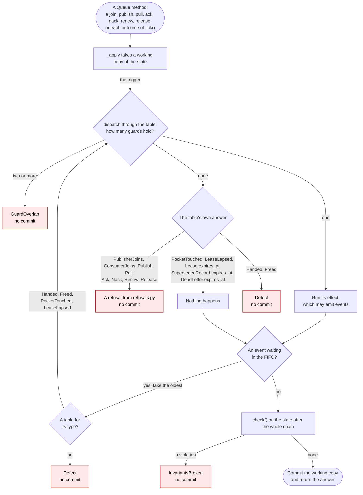

The package shows three interfaces, each in its own namespace, and the entities beside
them. `tests/test_interface.py` pins each namespace's list of names.

| Namespace | What it is for | Names |
| --- | --- | --- |
| `pachinko_double` | What a reader drives: the queue, its config and what it answers | `Queue`, `Config`, `Batch`, `NoPocketAvailable`, `TickReport`, `LeaseView`, `HeldRecordView`, `Snapshot` |
| `pachinko_double.harness` | What a test builds a queue with and checks its state by | `Clock`, `LeaseIds`, `FakeClock`, `SequentialLeaseIds`, `check`, `Violation`, `ConfigValues` |
| `pachinko_double.exceptions` | What the specification refuses, which a caller is meant to catch | `Refusal`, `ConfigRefused`, `PublisherAlreadyJoined`, `ConsumerAlreadyJoined`, `UnknownPublisher`, `UnknownConsumer`, `EqualRankRefused`, `PullRefused`, `LeaseFenced`, `RecordNotHeld`, `MarkConflict`, `ReleaseRefused` |
| `pachinko_double.exceptions` | What means the double itself is wrong | `Defect`, `GuardOverlap`, `InvariantsBroken` |
| `pachinko_double.model` | The entities, their enums and the durations | `Pocket`, `Record`, `Lease`, `Mark`, `MINUTE` and the rest of `model.py` |

A namespace only re-exports: each name is defined in its own module, such as
`refusals.py` or `effects.py`, and the tests import it from there. The rule modules are not listed at the top level;
each is imported as `pachinko_double.<module>`.

### Entities

Every entity is a frozen dataclass in `model.py`, with its enums beside it. The entity
`Queue` is the facade class `Queue` in `queue.py`; its one field, `next_position`, is
`Snapshot.next_position` in `inspection.py`.

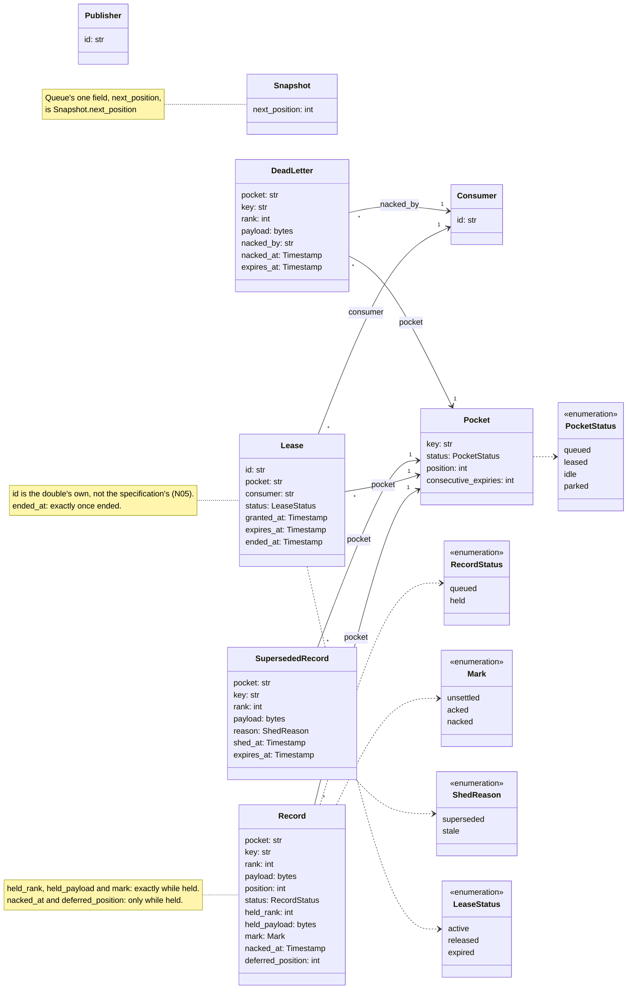

A reference to another entity is held as that entity's key: `Record.pocket` is a pocket
key, `Lease.consumer` a consumer id (spec note N06). `Lease` has one field the
specification does not declare, `id`, which is how an action names its lease (N05). The
derived sets, such as a pocket's `held_records` or a consumer's `active_leases`, are
computed once, in the snapshot. A pocket has at most one active lease and a consumer at
most one, but the double keeps ended leases too, so the `*` ends count them.

### Lifecycles

Each edge is labelled with the rules that take it, read from the rule modules. A pocket:

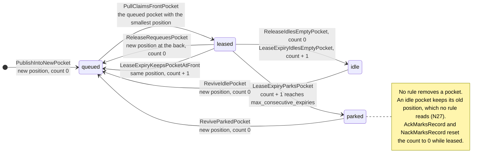

A record. A thin edge is an action or a publish, a thick edge is the `Freed` that the
lease's end sends, and a dotted edge is a version shed into one of the two queues, which
`tick()` drains. Every thick edge back to `queued` clears `held_rank`, `held_payload`,
`mark`, `nacked_at` and `deferred_position`. While held, `DeferBehindHeldVersion` sets
`deferred_position`, `Supersede` replaces the deferred version and `DropStalePublish`
leaves the record as it is; the held version and its mark never change. A record
outlasts its lease unless it is one of `pocket.ending_records`: held, marked acked or
nacked, with nothing deferred.

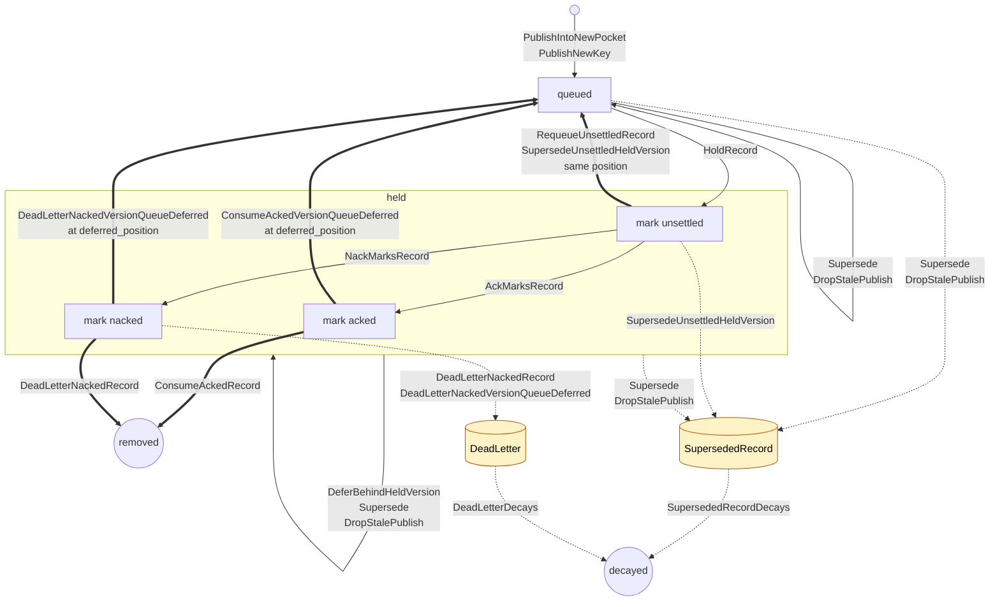

A lease. The self-loop only moves `expires_at`. Every edge into `released` or `expired`
ends it, writes `ended_at` and sends one `Freed` per held record:

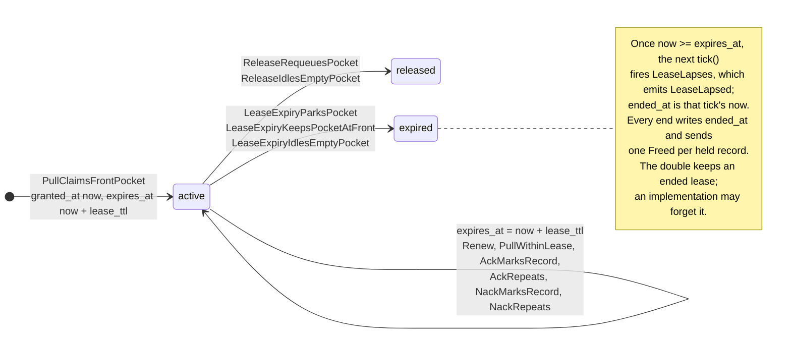

### Rules

The trigger is what the rule's `when:` names: an event, or for a clock trigger the
`Entity.field` it waits on.

Each module is a box. A stadium is a trigger, blue for an action or a clock trigger and
amber for an event a rule emits; under its name is its table, the trigger in
UPPER_SNAKE, so `Lease.expires_at` is `LEASE_EXPIRES_AT`. A solid edge from a trigger
leads to each rule of its table, and a dotted edge from a rule to the event it emits.
`Handed` goes out once per record of the batch, so zero or more times.
The five rules that end a lease call `end_lease`, drawn as a subroutine, and it emits
`Freed`. Any other rule with no dotted edge out emits nothing, `PublishIntoNewPocket` and
`DropStalePublish` among them.

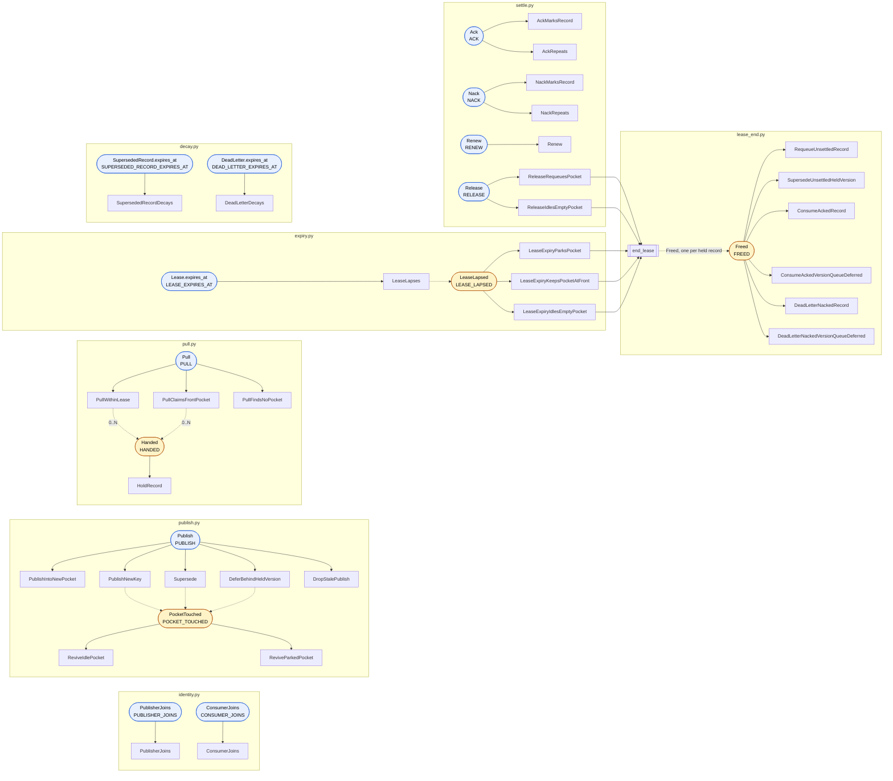

In each module the row's guard and effect are the functions named after the rule, such
as `_supersede_guard` and `_supersede` in `publish.py`. The five rules that end a lease
share one entry, `lease_end.end_lease`, which ends the lease and sends one `Freed` per
held record.

### Invariants

Every invariant is checked by `invariants.check(snapshot)`, which returns a `Violation`
for each one a state breaks. Its checker entry is `invariants.REGISTRY` under the
invariant's name, and the function is the name in snake case. Fifteen sit inside an
entity in the specification; the rest are top level.

| Invariant | Declared in | Checker function |
| --- | --- | --- |
| `LeasedHasOneActiveLease` | `Pocket` | `_leased_has_one_active_lease` |
| `UnleasedHasNoActiveLease` | `Pocket` | `_unleased_has_no_active_lease` |
| `IdleHasNoRecords` | `Pocket` | `_idle_has_no_records` |
| `ExpiriesWithinLimit` | `Pocket` | `_expiries_within_limit` |
| `HeldVersionNotNewer` | `Record` | `_held_version_not_newer` |
| `NackedHasItsTime` | `Record` | `_nacked_has_its_time` |
| `OnlyNackedHasNackTime` | `Record` | `_only_nacked_has_nack_time` |
| `DeferredHasArrivalPosition` | `Record` | `_deferred_has_arrival_position` |
| `OnlyDeferredHasArrivalPosition` | `Record` | `_only_deferred_has_arrival_position` |
| `DeferredArrivedAfterHeld` | `Record` | `_deferred_arrived_after_held` |
| `HeldCopiesAgree` | `Record` | `_held_copies_agree` |
| `ShedBeforeExpiry` | `SupersededRecord` | `_shed_before_expiry` |
| `NackedBeforeExpiry` | `DeadLetter` | `_nacked_before_expiry` |
| `GrantedBeforeExpiry` | `Lease` | `_granted_before_expiry` |
| `EndedAfterGrant` | `Lease` | `_ended_after_grant` |
| `ExpiryLimitPositive` | top level | `_expiry_limit_positive` |
| `PullBatchPositive` | top level | `_pull_batch_positive` |
| `LeaseTtlNonNegative` | top level | `_lease_ttl_non_negative` |
| `SupersededTtlNonNegative` | top level | `_superseded_ttl_non_negative` |
| `DeadLetterTtlNonNegative` | top level | `_dead_letter_ttl_non_negative` |
| `UniquePublisherId` | top level | `_unique_publisher_id` |
| `UniqueConsumerId` | top level | `_unique_consumer_id` |
| `OnePocketPerKey` | top level | `_one_pocket_per_key` |
| `OneRecordPerKeyPerPocket` | top level | `_one_record_per_key_per_pocket` |
| `OneActiveLeasePerPocket` | top level | `_one_active_lease_per_pocket` |
| `OneActiveLeasePerConsumer` | top level | `_one_active_lease_per_consumer` |
| `OutstandingOnlyWhileLeased` | top level | `_outstanding_only_while_leased` |
| `MarkedPocketHasNoExpiries` | top level | `_marked_pocket_has_no_expiries` |
| `UniquePocketPosition` | top level | `_unique_pocket_position` |
| `UniqueRecordPosition` | top level | `_unique_record_position` |
| `PocketPositionsBelowNext` | top level | `_pocket_positions_below_next` |
| `RecordPositionsBelowNext` | top level | `_record_positions_below_next` |
| `ArrivalPositionUnoccupied` | top level | `_arrival_position_unoccupied` |
| `UniqueArrivalPosition` | top level | `_unique_arrival_position` |
| `ArrivalPositionsBelowNext` | top level | `_arrival_positions_below_next` |

The five config invariants are also enforced when a `Config` is made: one that breaks
them raises `ConfigRefused` (N09). Each invariant's positive control, a hand-built state
that breaks it, is in `tests/test_invariants.py`.

## What stands in for time and for the implementation

The specification leaves some things to time and some to the implementation. The double
makes each of them explicit, so that every run is the same run:

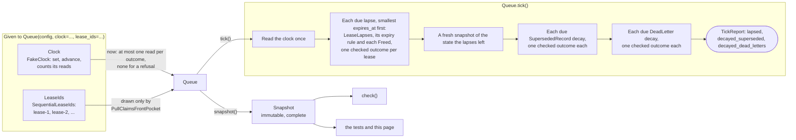

- **The clock.** `Queue` reads time only through the `Clock` it is given (`effects.py`).
  Times are whole milliseconds (N01). One outcome reads the clock at most once, and a
  refused action reads none (N28).
- **Lease ids.** The specification gives a lease no identity, but every action names one.
  `SequentialLeaseIds` answers `lease-1`, `lease-2`, and so on (N05, N15).
- **`tick()`.** The double has no background time. A lease lapses, and a superseded record
  or a dead letter decays, only when a caller runs `Queue.tick()` (N33 to N35). So an
  action after a lease's `expires_at` but before the tick still succeeds, which is
  branch A of [decision 0019](../docs/decisions/0019-service-runtime-tokio-and-http.md).
- **The inspection seam.** `Queue.snapshot()` returns the whole committed state as one
  immutable `Snapshot`. The checker and the tests read state only through `Snapshot`;
  `_apply` checks a snapshot of its working state before it commits. A pull answers a
  `Batch` or `NoPocketAvailable`; the other actions answer nothing, and their effect is
  read from the snapshot (N13, N24, N32).
  `Queue.lease_view(consumer_id)` is the `Consuming` surface's exposure of the consumer's
  active lease.

The snapshot keeps ended leases, and lists entities in the order the double stored them.
Neither is a claim about the specification. On the investigation in
`.scratch/python-double/PD07-inspection-contract.md` the maintainer ruled on two of
these shapes: an implementation may forget an ended lease, and a pocket's records are a
set, read by key. The order of the other listings is not ruled on. One of them reaches
behaviour: a tick breaks a tie between two lapses by the order the leases are listed in
(finding 7 of [`SPEC-NOTES.md`](SPEC-NOTES.md)). The walkthrough below reads a pocket's
records by key, never by their place in the snapshot.

## Walkthrough: Scenarios A to D

Scenarios A to D are the catalog's S078 to S081: four cases of a lease's end under
[decision 0020](../docs/decisions/0020-held-set-until-lease-ends.md). In each, consumer `c1` holds key `k` at rank 1 (`v1`) while a
newer rank arrives and is deferred behind it; what happens when the lease ends depends on
`c1`'s mark. The tagged tests in `tests/test_endings.py` run each scenario both ways, by
release and by lapse. Here A and C end by release and B and D by lapse.

The positions and lease ids printed below are the double's: its first position is 0 and
its lease ids are sequential (N04, N05). Only their order and their distinctness are the
specification's.

### The setting

A queue with short TTLs and a fake clock at 0, then a publisher `p` and consumers `c1` and
`c2`. `show` prints the queue's position counter, each pocket, the named records of pocket
`pk` (looked up by key), each lease, and the superseded and dead-letter queues, field by
field in the specification's names, leaving out fields that are null.

```pycon
>>> from dataclasses import fields
>>> from pachinko_double import Config, Queue
>>> from pachinko_double.harness import FakeClock, SequentialLeaseIds, check

>>> def setting():
...     clock = FakeClock(0)
...     config = Config(lease_ttl=1_000, superseded_ttl=5_000, dead_letter_ttl=7_000)
...     queue = Queue(config, clock=clock, lease_ids=SequentialLeaseIds())
...     queue.publisher_joins("p")
...     queue.consumer_joins("c1")
...     queue.consumer_joins("c2")
...     return queue, clock

>>> def line(entity, *leave_out):
...     return ", ".join(
...         f"{field.name}={getattr(entity, field.name)}"
...         for field in fields(entity)
...         if field.name not in leave_out and getattr(entity, field.name) is not None
...     )

>>> def show(queue, *record_keys):
...     state = queue.snapshot()
...     print("next_position:", state.next_position)
...     for pocket in state.pockets:
...         print("pocket:", line(pocket))
...     for key in record_keys:
...         record = state.record("pk", key)
...         print(f"record {key}:", "none" if record is None else line(record, "pocket", "key"))
...     for lease in state.leases:
...         print("lease:", line(lease))
...     for entry in state.superseded:
...         print("superseded:", line(entry))
...     for entry in state.dead_letters:
...         print("dead letter:", line(entry))

```

### The common start

Every scenario starts the same way. `k` at rank 1 and then `early` are published into
pocket `pk`. `PublishIntoNewPocket` allots the pocket a position and then `k` one, and
`PublishNewKey` allots `early` the next:

```pycon
>>> queue, clock = setting()
>>> queue.publish("p", "pk", "k", 1, b"v1")
>>> queue.publish("p", "pk", "early", 1, b"e")
>>> show(queue, "k", "early")
next_position: 3
pocket: key=pk, status=queued, position=0, consecutive_expiries=0
record k: rank=1, payload=b'v1', position=1, status=queued
record early: rank=1, payload=b'e', position=2, status=queued

```

`c1` pulls one record. `PullClaimsFrontPocket` leases the front pocket under a new lease
that expires `lease_ttl` later, and `HoldRecord` holds the oldest record, `k`, copying
its rank and payload into `held_rank` and `held_payload`:

```pycon
>>> batch = queue.pull("c1", 1)
>>> batch.lease, [record.key for record in batch.records]
('lease-1', ['k'])
>>> show(queue, "k")
next_position: 3
pocket: key=pk, status=leased, position=0, consecutive_expiries=0
record k: rank=1, payload=b'v1', position=1, status=held, held_rank=1, held_payload=b'v1', mark=unsettled
lease: id=lease-1, pocket=pk, consumer=c1, status=active, granted_at=0, expires_at=1000

```

At 10 ms, `k` is published at rank 3. The record is held with nothing deferred, so
`DeferBehindHeldVersion` applies: `rank` and `payload` take `v3`, the held version does
not change, and `deferred_position` takes the next position, where `v3` arrived:

```pycon
>>> clock.set(10)
>>> queue.publish("p", "pk", "k", 3, b"v3")
>>> show(queue, "k")
next_position: 4
pocket: key=pk, status=leased, position=0, consecutive_expiries=0
record k: rank=3, payload=b'v3', position=1, status=held, held_rank=1, held_payload=b'v1', mark=unsettled, deferred_position=3
lease: id=lease-1, pocket=pk, consumer=c1, status=active, granted_at=0, expires_at=1000

```

The scenarios repeat that start through this function:

```pycon
>>> def v3_deferred_behind_v1():
...     queue, clock = setting()
...     queue.publish("p", "pk", "k", 1, b"v1")
...     queue.publish("p", "pk", "early", 1, b"e")
...     queue.pull("c1", 1)
...     clock.set(10)
...     queue.publish("p", "pk", "k", 3, b"v3")
...     return queue, clock

```

The lease's end sends a `Freed` for `k`, and the `Freed` table picks one of six rules by
whether a newer version is deferred behind `v1` and by `c1`'s mark. Scenarios A to D take
the highlighted three:

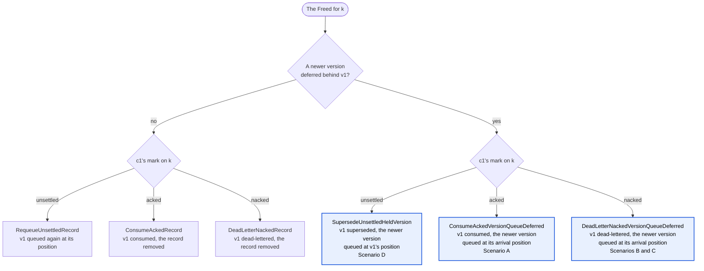

### Scenario A: the acked version is consumed, and `v3` is queued where it arrived

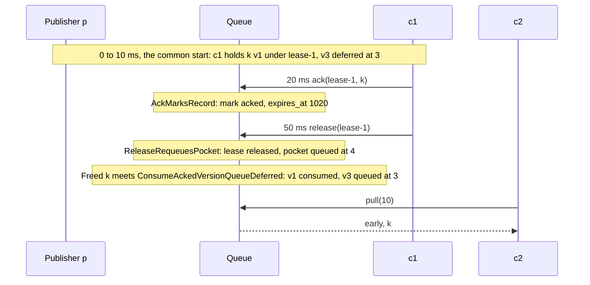

The records of `pk` in position order, and the order `c2` pulls them in after the end:

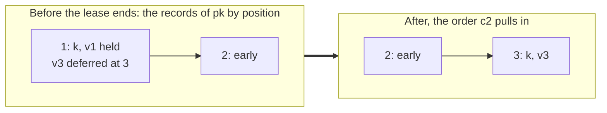

At 20 ms `c1` acks `k`. `AckMarksRecord` marks it and extends the lease; nothing is
removed yet:

```pycon
>>> queue, clock = v3_deferred_behind_v1()
>>> clock.set(20)
>>> queue.ack("c1", "lease-1", "k")
>>> show(queue, "k")
next_position: 4
pocket: key=pk, status=leased, position=0, consecutive_expiries=0
record k: rank=3, payload=b'v3', position=1, status=held, held_rank=1, held_payload=b'v1', mark=acked, deferred_position=3
lease: id=lease-1, pocket=pk, consumer=c1, status=active, granted_at=0, expires_at=1020

```

At 50 ms `c1` releases. `ReleaseRequeuesPocket` ends the lease and queues the pocket at
the next position, and the `Freed` for `k` meets `ConsumeAckedVersionQueueDeferred`: `v1`
is consumed and recorded nowhere, and `v3` is queued at its arrival position, 3, behind
`early`:

```pycon
>>> clock.set(50)
>>> queue.release("c1", "lease-1")
>>> show(queue, "k")
next_position: 5
pocket: key=pk, status=queued, position=4, consecutive_expiries=0
record k: rank=3, payload=b'v3', position=3, status=queued
lease: id=lease-1, pocket=pk, consumer=c1, status=released, granted_at=0, expires_at=1020, ended_at=50
>>> [record.key for record in queue.pull("c2", 10).records]
['early', 'k']

```

### Scenario B: the nacked version is dead-lettered, and `v3` is queued where it arrived

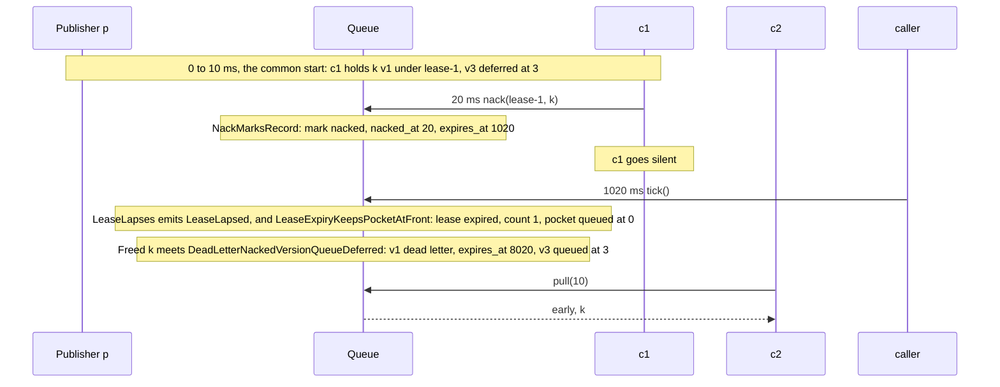

The records of `pk` in position order, and the order `c2` pulls them in after the end:


At 20 ms `c1` nacks `k`. `NackMarksRecord` marks it with the nack's time and extends the
lease. No dead letter appears yet:

```pycon
>>> queue, clock = v3_deferred_behind_v1()
>>> clock.set(20)
>>> queue.nack("c1", "lease-1", "k")
>>> show(queue, "k")
next_position: 4
pocket: key=pk, status=leased, position=0, consecutive_expiries=0
record k: rank=3, payload=b'v3', position=1, status=held, held_rank=1, held_payload=b'v1', mark=nacked, nacked_at=20, deferred_position=3
lease: id=lease-1, pocket=pk, consumer=c1, status=active, granted_at=0, expires_at=1020

```

`c1` then goes silent, and the clock reaches the lease's `expires_at`. The tick lapses
it: `LeaseLapses` emits `LeaseLapsed`, and below the parking threshold with a record that
outlasts the lease, `LeaseExpiryKeepsPocketAtFront` ends the lease `expired`, counts one
expiry and queues the pocket at its old position. The `Freed` for `k` meets
`DeadLetterNackedVersionQueueDeferred`: `v1` becomes a dead letter with its nack's time,
and `v3` is queued at its arrival position:

```pycon
>>> clock.set(1_020)
>>> [lease.id for lease in queue.tick().lapsed]
['lease-1']
>>> show(queue, "k")
next_position: 4
pocket: key=pk, status=queued, position=0, consecutive_expiries=1
record k: rank=3, payload=b'v3', position=3, status=queued
lease: id=lease-1, pocket=pk, consumer=c1, status=expired, granted_at=0, expires_at=1020, ended_at=1020
dead letter: pocket=pk, key=k, rank=1, payload=b'v1', nacked_by=c1, nacked_at=20, expires_at=8020
>>> [record.key for record in queue.pull("c2", 10).records]
['early', 'k']

```

### Scenario C: `v3` is shed when `v5` arrives, and `v5` takes `v3`'s arrival position

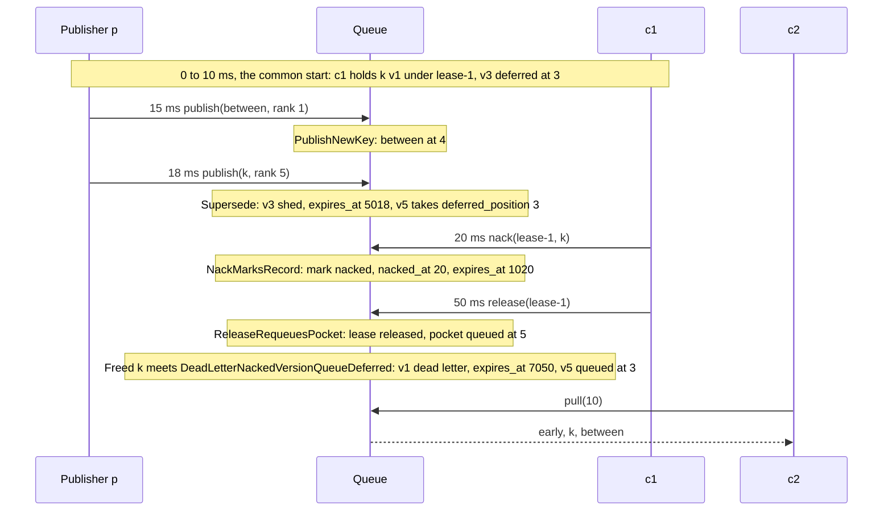

The records of `pk` in position order, and the order `c2` pulls them in after the end:

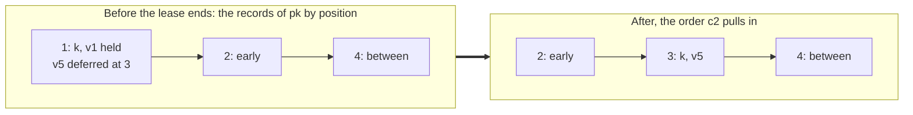

At 15 ms a new key, `between`, is published, and at 18 ms `k` at rank 5. A version is
already deferred, so `Supersede` applies: `v3`, which no consumer holds, is shed to the
superseded queue at once, and `v5` takes its place and its arrival position. The held
`v1` does not change:

```pycon
>>> queue, clock = v3_deferred_behind_v1()
>>> clock.set(15)
>>> queue.publish("p", "pk", "between", 1, b"b")
>>> clock.set(18)
>>> queue.publish("p", "pk", "k", 5, b"v5")
>>> show(queue, "k")
next_position: 5
pocket: key=pk, status=leased, position=0, consecutive_expiries=0
record k: rank=5, payload=b'v5', position=1, status=held, held_rank=1, held_payload=b'v1', mark=unsettled, deferred_position=3
lease: id=lease-1, pocket=pk, consumer=c1, status=active, granted_at=0, expires_at=1000
superseded: pocket=pk, key=k, rank=3, payload=b'v3', reason=superseded, shed_at=18, expires_at=5018

```

At 20 ms `c1` nacks `k`, and at 50 ms releases. `v1` becomes a dead letter, its expiry
measured from the lease's end, and `v5` is queued at 3, ahead of `between` at 4:

```pycon
>>> clock.set(20)
>>> queue.nack("c1", "lease-1", "k")
>>> clock.set(50)
>>> queue.release("c1", "lease-1")
>>> show(queue, "k", "between")
next_position: 6
pocket: key=pk, status=queued, position=5, consecutive_expiries=0
record k: rank=5, payload=b'v5', position=3, status=queued
record between: rank=1, payload=b'b', position=4, status=queued
lease: id=lease-1, pocket=pk, consumer=c1, status=released, granted_at=0, expires_at=1020, ended_at=50
superseded: pocket=pk, key=k, rank=3, payload=b'v3', reason=superseded, shed_at=18, expires_at=5018
dead letter: pocket=pk, key=k, rank=1, payload=b'v1', nacked_by=c1, nacked_at=20, expires_at=7050
>>> [record.key for record in queue.pull("c2", 10).records]
['early', 'k', 'between']

```

### Scenario D: the unsettled version is superseded at the end, and `v3` takes its position

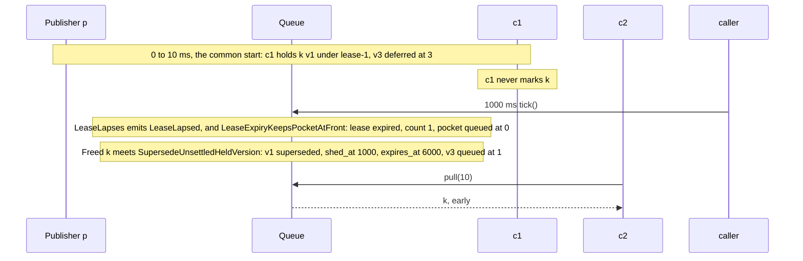

The records of `pk` in position order, and the order `c2` pulls them in after the end:

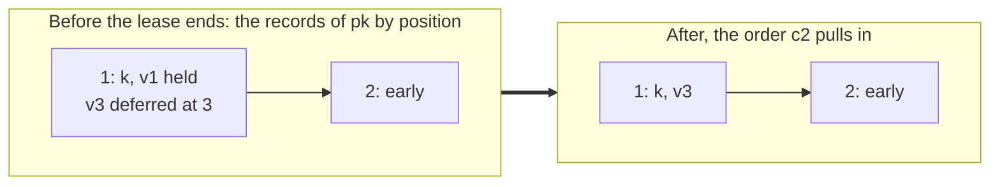

`c1` never marks `k`, and the lease lapses at its `expires_at`. The `Freed` for `k` meets
`SupersedeUnsettledHeldVersion`: `v1` is shed to the superseded queue with the lease's
end as `shed_at`, and `v3` is queued at `v1`'s position, 1, ahead of `early`. No consumer
acked or nacked `k`, so it keeps its place:

```pycon
>>> queue, clock = v3_deferred_behind_v1()
>>> clock.set(1_000)
>>> [lease.id for lease in queue.tick().lapsed]
['lease-1']
>>> show(queue, "k")
next_position: 4
pocket: key=pk, status=queued, position=0, consecutive_expiries=1
record k: rank=3, payload=b'v3', position=1, status=queued
lease: id=lease-1, pocket=pk, consumer=c1, status=expired, granted_at=0, expires_at=1000, ended_at=1000
superseded: pocket=pk, key=k, rank=1, payload=b'v1', reason=superseded, shed_at=1000, expires_at=6000
>>> [record.key for record in queue.pull("c2", 10).records]
['k', 'early']

```

Every state above passed the invariant checker when it was committed, and the last one
still does:

```pycon
>>> check(queue.snapshot())
()

```
