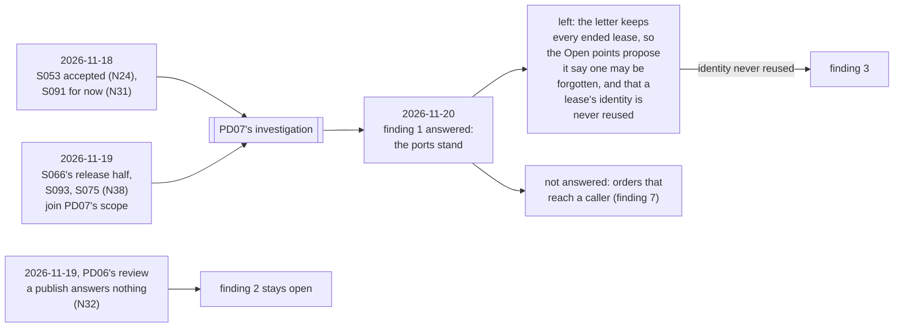
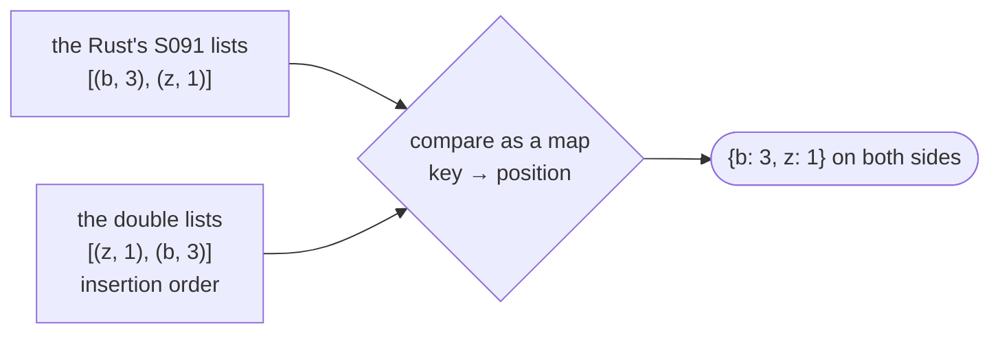
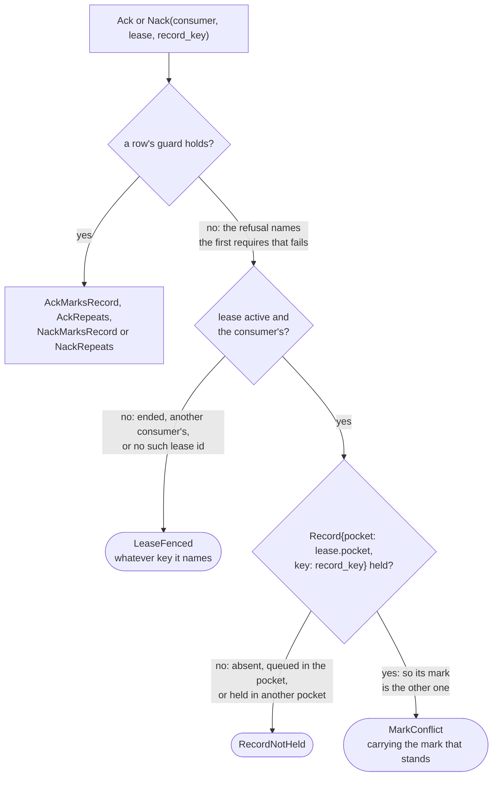
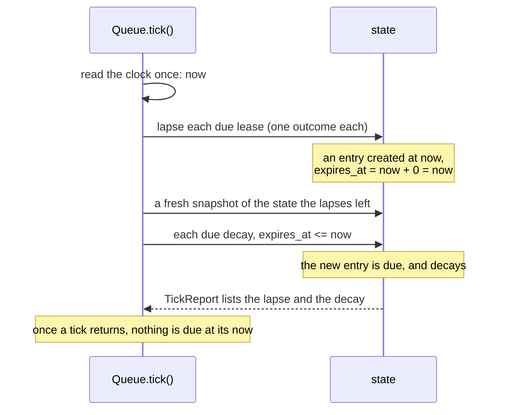
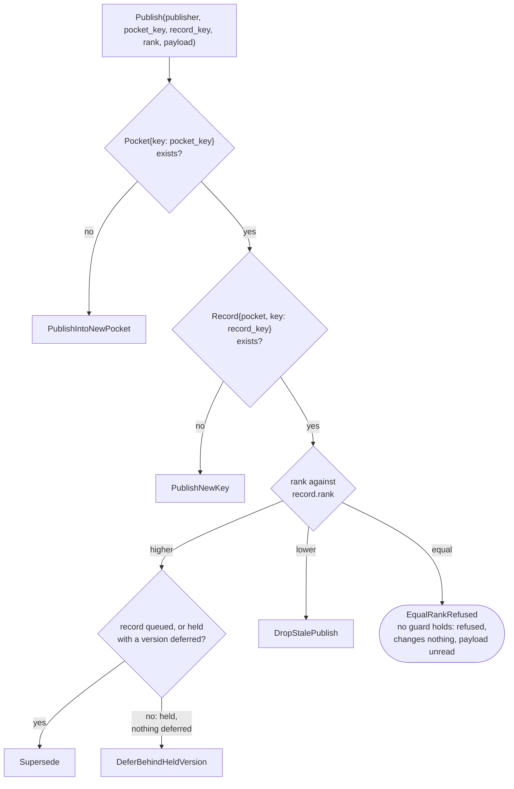
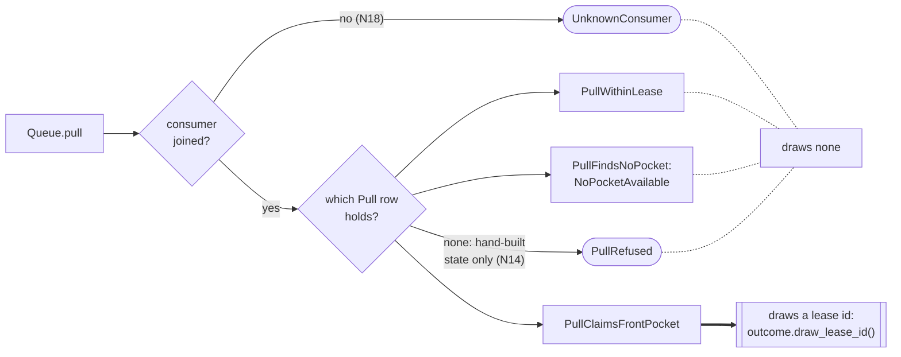
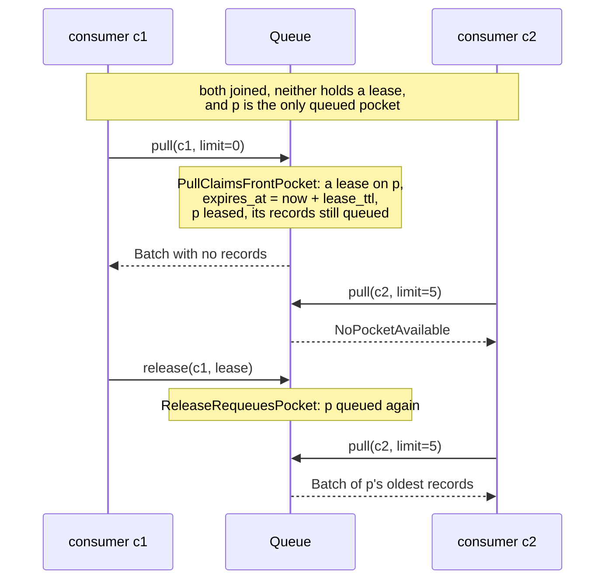
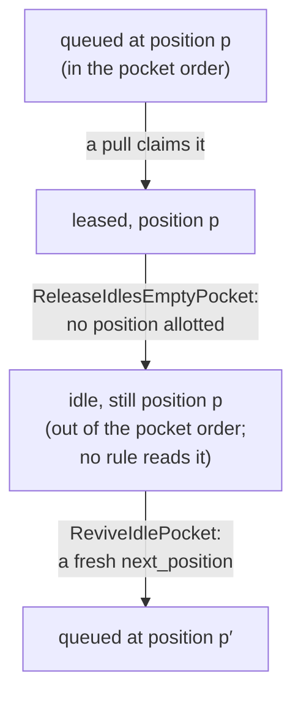
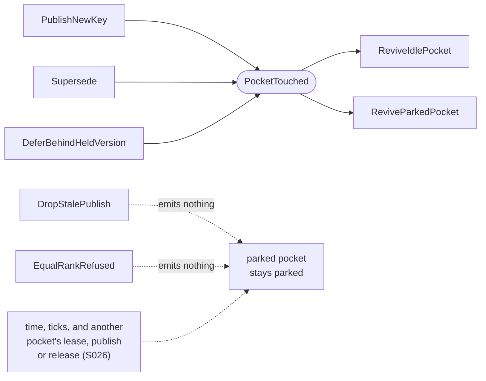
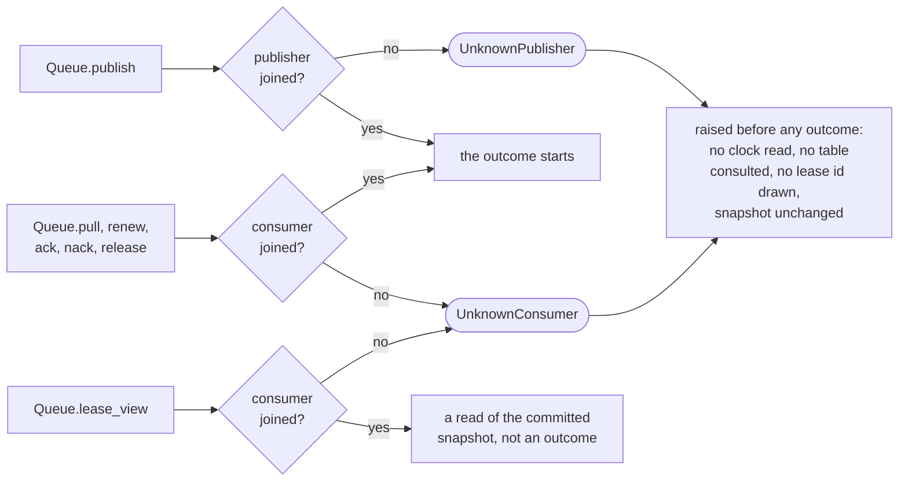

# Specification notes from the Python double

The Python double under `double/` is derived from `docs/specs/pachinko.allium` alone.
This file records every place where the specification was silent or ambiguous, or
forced an interpretation, and every catalog row the double ports although it asserts
more than the specification states (labelled `impl-choice`). It is the deliverable the
maintainer uses to judge the specification: each note ends with the question it leaves.

Each note gives its id, the ticket that wrote it, the rule, invariant, entity or comment
it concerns, what the specification says, what the double does, and the question.

The findings come first. The 38 notes follow, each under one of four headings and in id
order within it, keeping the id it was written with. By the ticket that wrote it:

| Ticket | [A ported scenario disagreed](#where-a-ported-scenario-disagreed-with-the-specification) | [Ambiguous](#where-the-specification-is-ambiguous) | [Silent](#where-the-specification-is-silent) | [The `impl-choice` rows](#the-impl-choice-rows) |
| --- | --- | --- | --- | --- |
| PD01 | — | [N02](#n02-a-payload-is-bytes)†, [N06](#n06-a-reference-to-an-entity-is-that-entitys-key)†, [N07](#n07-a--b-in-an-invariant-compares-entities-not-their-fields), [N08](#n08-a-field-declared-when-status---is-the-entitys-shape-not-an-invariant)†, [N12](#n12-a-join-with-an-id-already-taken-is-refused) | [N01](#n01-timestamps-and-durations-are-whole-milliseconds), [N03](#n03-a-rank-is-an-unbounded-integer), [N05](#n05-a-lease-has-an-id-which-the-specification-does-not-declare), [N11](#n11-the-equal-rank-publish-is-the-publish-tables-refusal-equalrankrefused) | [N04](#n04-the-queues-first-position-is-0-s011-s014-and-s016-are-impl-choice), [N09](#n09-a-config-that-breaks-a-config-invariant-is-refused-when-it-is-made-s005-is-impl-choice), [N10](#n10-a-publish-by-a-publisher-that-never-joined-is-refused-impl-choice) |
| PD02 | [N13](#n13-a-batch-names-its-lease-and-pocket-by-key-and-carries-no-expiry) | [N14](#n14-the-pull-tables-refusal-is-unreachable) | [N15](#n15-a-pull-draws-a-lease-id-only-when-it-creates-a-lease)†, [N17](#n17-s019s-large-ranks-are-a-64-bit-integers-extremes-not-the-doubles), [N19](#n19-a-pull-whose-limit-is-not-positive-still-claims-a-pocket), [N20](#n20-renews-refusal-is-leasefenced-and-an-unknown-lease-id-meets-it) | [N16](#n16-s012-s015-and-s022-assert-absolute-positions-impl-choice), [N18](#n18-a-pull-or-a-renew-by-a-consumer-that-never-joined-is-refused-impl-choice) |
| PD03 | [N24](#n24-an-ended-lease-stays-in-the-state-and-a-release-and-a-mark-answer-nothing) | [N21](#n21-the-refusals-of-a-mark-are-the-doubles-leasefenced-recordnotheld-markconflict), [N26](#n26-the-release-tables-refusal-past-fencing-is-unreachable), [N28](#n28-a-refused-action-reads-no-clock-s085) | [N25](#n25-one-lease-end-sends-freed-smallest-held-position-first), [N27](#n27-an-idle-pocket-keeps-its-position) | [N22](#n22-an-ack-nack-release-or-lease-read-by-a-consumer-that-never-joined-is-refused-impl-choice), [N23](#n23-s090s-lease-view-lists-the-held-records-smallest-position-first-impl-choice) |
| PD04 | [N31](#n31-s091s-record-order-is-the-rusts-inspection-shape-not-behaviour), [N32](#n32-a-deferral-answers-nothing-where-the-rust-answers-superseded) | — | [N30](#n30-a-deferred-version-shed-by-a-later-publish-takes-the-publishs-now) | [N29](#n29-s091-pins-the-order-of-the-entries-one-lease-end-creates-impl-choice) |
| PD05 | [N38](#n38-pd05s-ports-of-the-rusts-inspection-shapes) | [N35](#n35-an-entry-a-lapse-creates-with-a-zero-ttl-decays-in-the-same-tick), [N37](#n37-the-expiry-rules-answer-when-no-guard-holds-is-unreachable-through-tick) | [N33](#n33-tick-is-the-doubles-only-clock-and-it-reports-what-it-did), [N34](#n34-one-tick-lapses-in-expires_at-order-then-decays-in-queue-order), [N36](#n36-only-a-publish-revives-a-parked-pocket-open-question-7-closed) | — |

† records a reading and leaves no question of its own.

[`README.md`](README.md) maps the specification's entities, rules and invariants to the
double's classes, tables and checker entries.

## Findings

Each finding is a question for the maintainer, with the notes that hold its evidence.
None of them has been applied to the specification, and none answers one of its open
questions. A note whose question is "none" is not a finding; it records a reading, and is
listed at the end of this section.

### The maintainer's rulings so far

The maintainer accepted three sets of ports for now. Each keeps the specification as it
stands and treats the Rust's assertion as its inspection shape, not as behaviour. None
of the three settled a question about the specification. The fourth and fifth, and
what the fifth leaves, are drawn below; the fifth rests on
`.scratch/python-double/PD07-inspection-contract.md`.

| Date | Ruling | Rows | Note |
| --- | --- | --- | --- |
| 2026-11-18 | The Rust's empty lease registry after a release is its inspection shape. The double keeps the ended lease and ports the specification's facts. | S053 | [N24](#n24-an-ended-lease-stays-in-the-state-and-a-release-and-a-mark-answer-nothing) |
| 2026-11-18 | The port that compares S091's kept positions by key is accepted for now, with further investigation asked for. | S091 | [N31](#n31-s091s-record-order-is-the-rusts-inspection-shape-not-behaviour) |
| 2026-11-19 | The three ports stand as the Rust's inspection shape, and PD07's scope gains them. | S066's release half, S093, S075's stored pocket order | [N38](#n38-pd05s-ports-of-the-rusts-inspection-shapes) |
| 2026-11-19 | A publish answers nothing, as the specification states. The ported rows assert that answer and do not port the Rust's outcomes; whether the specification should name one stays open. | Every ported publish row the Rust checks for an outcome | [N32](#n32-a-deferral-answers-nothing-where-the-rust-answers-superseded) |
| 2026-11-20 | The three inspection shapes are the implementation's, not the specification's. An implementation may keep an ended lease or forget it. A pocket's records are a set, read by key. The pocket order is only derived from positions. The ports stand. | S053, S066's release half, S075, S091, S093 | [N24](#n24-an-ended-lease-stays-in-the-state-and-a-release-and-a-mark-answer-nothing), [N31](#n31-s091s-record-order-is-the-rusts-inspection-shape-not-behaviour), [N38](#n38-pd05s-ports-of-the-rusts-inspection-shapes) |

### Questions for the maintainer

The first two weigh most: they decide what an implementation must show a caller. The
first is answered, and it leaves a proposal.

The matrix shows which notes each finding rests on.

![A matrix of the 15 findings against the 38 notes, grouped by heading. Finding 1 (answered): N24, N31, N38. Finding 2: N13, N24, N32, N33. Finding 3: N05, N15, N23. Finding 4: N10, N18, N22. Finding 5: N11, N12, N20, N21. Finding 6: N14, N26, N37. Finding 7: N23, N25, N29, N34. Finding 8: N30. Finding 9: N33, N35. Finding 10: N28. Finding 11: N19. Finding 12: N27. Finding 13: N01, N03, N04, N16, N17. Finding 14: N09. Finding 15: N07. No finding cites N02, N06, N08 or N36. N24, N31, N32 and N38 carry a ruling.](diagrams/findings-notes.svg)

1. **Is the inspection shape part of the contract?** Five Rust tests assert facts about
   the Rust's snapshot that the specification does not state. S053's and S066's empty
   lease registry and S091's and S093's record order fail when ported literally against a
   double that follows the specification. S075's stored pocket order has nothing in the
   double to assert, since the double derives that order from positions. PD07 asked the
   three questions this leaves. Is an ended lease part of the observable state, and what does
   fencing by lease id need kept? Is the order in which a pocket's records are listed part
   of the contract, and if so which order? Is the order of the queued pockets stored, or
   only derived from their positions? (N24, N31, N38; S053, S066, S075, S091, S093.)
   - **Answered (2026-11-20):** no, for all three. An ended lease is an implementation
     detail, a pocket's records are a set read by key, and the pocket order is only
     derived. `.scratch/python-double/PD07-inspection-contract.md` holds the evidence.
   - **What it leaves:** the specification's letter keeps every ended lease, and says
     nowhere that one may be forgotten or that a lease's identity is never reused. The
     ticket's Open points propose that it say both. The second belongs with finding 3.
   - **What it does not answer:** the orders that reach a caller or behaviour, which are
     finding 7's.
2. **Should the surfaces name what each trigger answers?** The specification's rules
   answer a pull with `Batch` or `NoPocketAvailable` and every other trigger with
   nothing. A `Batch` carries no `expires_at`, which a consumer needs in order to renew
   in time (N13). A publish answers nothing, where decision 0020 gives a deferral the
   answer `superseded` (N32). A release and a mark answer nothing (N24). What a tick
   reports is the implementation's choice (N33).
3. **Should a lease have an identity in the specification, and should the `Consuming`
   surface expose it?** Every action names its lease, and fencing has to tell an ended
   lease from its successor over the same pocket and consumer. The double adds `Lease.id`,
   and the surface's lease view exposes no id (N05, N15, N23).
4. **Should a publish, a pull, a renew, an ack, a nack and a release require a joined
   publisher or consumer?** Each trigger takes a `Publisher` or a `Consumer` entity, which
   only a join creates, and nothing says what an id that never joined does. No Publish
   rule reads the publisher at all. The consumer rules compare it with a lease's
   consumer, which says nothing of a consumer that never joined. The double refuses such
   an id before any rule runs, and every such test is `impl-choice` (N10, N18, N22).
5. **Should the specification name its refusals, and the order in which an action's
   `requires` are checked?** The specification names none of its rejections, so the
   double's `EqualRankRefused`, `LeaseFenced`, `RecordNotHeld`, `MarkConflict` and the
   rest are its own; decision 0020 names `MarkConflict` for the Rust. S070's ack by another consumer of
   a key its lease does not hold is fenced, not "not held", only because the double checks
   the lease first (N11, N20, N21). And should a second join with a taken id be refused,
   as the double and the Rust do, or succeed and change nothing, which the words also
   allow (N12)?
6. **Is a `requires` that restates an invariant a guard in its own right, or a
   restatement?** Pull's and Release's `requires: pocket.status = ...` cannot fail in a
   state that holds `UnleasedHasNoActiveLease`, so the Pull and Release refusals left
   past fencing are reached only by a hand-built dispatch. If they are restatements, the
   specification could say so or drop them (N14, N26). The expiry rules'
   `lease.status = active` and `lease.expires_at <= now` restate `LeaseLapses`, not an
   invariant, and the Lease expiry comment gives them a job: a lapse processed after a
   release, or after an action that moved `expires_at` on, stops at them. They cannot
   fail in the double only because `tick()` offers only due active leases and applies
   each lapse in the outcome that found it due, so the `LeaseLapsed` table's answer when
   no guard holds is reached only by a hand-built dispatch too. N37 asks whether, in that
   chain, they are guards in their own right or restatements of `LeaseLapses`.
7. **Should the specification order the entries one lease end, or one tick, creates, or
   say that their order is not observable?** The double sends one lease end's `Freed`
   smallest held position first, and S091 pins that order as `impl-choice`; decision 0020
   says the specification leaves the order of one lease end's entries open (N25, N29).
   One tick lapses in `expires_at` order, which a test with no scenario tag pins (N34).
   The lease view's order of held records, smallest position first in S090, is the same
   kind of question (N23).
8. **Should a reader of the superseded queue be told that `shed_at` does not order a
   key's versions?** A deferred version shed by a publish takes the publish's `now`, and a
   held version shed at the lease's end takes `ended_at`, so a key's lowest rank can be
   shed last (N30).
9. **How are the temporal triggers processed?** The specification names no process that
   notices a due trigger (N33). Is "nothing is due once a tick returns" intended, so that
   an entry a lapse creates with a zero TTL decays in the same tick (N35)? PD05's
   hand-back also asks whether a tick should be atomic as a whole; the double commits each
   lapse and each decay as it goes.
10. **Does a rejected action have a `now`?** S085 says a changed mark "reads no clock".
    The double reads the clock at most once per outcome and only when a rule reads `now`,
    so a refusal reads none. Is that behaviour the specification should state, or a
    property of the Rust's clock (N28)?
11. **Is a claim that hands nothing intended?** A pull with a limit that is not positive
    claims the front pocket and hands an empty batch, so a consumer probing with
    `limit = 0` takes the pocket from every other consumer until its lease ends (N19).
12. **Does an idle pocket's position mean anything?** An idle pocket keeps the position
    it had, which no rule reads and a revival replaces (N27).
13. **Should the specification fix its numeric domains?** Is the queue's first position
    meant to be unspecified, given that six rows assert absolute positions that hold only
    because the double starts at 0 (N04, N16)? Should a rank be bounded, so that S019's
    64-bit extremes are every implementation's boundary (N03, N17)? Does any rule depend
    on a time resolution finer than a millisecond, or on two events never sharing a
    timestamp (N01)?
14. **Is "refused at configuration" the intended reading of "the model is defined
    for"?** The double refuses a config that breaks a config invariant when it is made,
    and S005's compile-time refusal becomes a run-time one (N09).
15. **Is `ArrivalPositionUnoccupied` meant to range over a record paired with itself?**
    It has no `a != b`, so it overlaps `DeferredArrivedAfterHeld`. That is harmless, but
    the two then name the same state (N07).

What each trigger answers, the subject of finding 2, as the notes record it:

| Trigger | The specification | The double | The Rust | Note |
| --- | --- | --- | --- | --- |
| publish | nothing; the surface names no outcome | nothing | `PublishOutcome::Superseded` for a deferral, from decision 0020 | [N32](#n32-a-deferral-answers-nothing-where-the-rust-answers-superseded) |
| pull | `Batch` or `NoPocketAvailable` | `Batch` (consumer id, lease id, pocket key, records) or `NoPocketAvailable`; no expiry | the batch answers the lease's `expires_at` | [N13](#n13-a-batch-names-its-lease-and-pocket-by-key-and-carries-no-expiry) |
| renew | nothing; it ensures the new `expires_at` | nothing | the lease's `expires_at` | [N13](#n13-a-batch-names-its-lease-and-pocket-by-key-and-carries-no-expiry) |
| ack, nack | nothing | nothing | `SettleOutcome` | [N24](#n24-an-ended-lease-stays-in-the-state-and-a-release-and-a-mark-answer-nothing) |
| release | nothing | nothing | `(PocketFate, Lease)` | [N24](#n24-an-ended-lease-stays-in-the-state-and-a-release-and-a-mark-answer-nothing) |
| the clock | no process named, no surface reports | `tick()` answers a `TickReport`: the lapsed leases and the decayed entries | the lapsed leases and two counts | [N33](#n33-tick-is-the-doubles-only-clock-and-it-reports-what-it-did) |

### Open questions left untouched

The specification has two open questions left, numbered as
`docs/how-to/work-with-the-specs.md` numbers them. No note answers either, and the
double adds no rule for either:

- Question 2: "Who reads the superseded and dead-letter queues, and what can they do: an
  operator listing, a replay action back into the pocket, or a consumable stream under
  the lease model? The answer also fixes what an entry must carry; reason and nacked_by
  are kept on that assumption."
- Question 6: "Should a newly created pocket be able to jump to the front of the queue,
  opt-in, for fast first service?"

The maintainer has ruled on both, and `tickets/T39-decide-q2-q6.md` records the rulings.
Each adds behaviour, so its line stays in the specification until that ticket lands it,
and the double changes with it then.

The maintainer closed the other four, and none of the closures changes the double:

| Question | Closed | Ruling | The double |
| --- | --- | --- | --- |
| 3, capacity beyond shedding the decaying queues | 2026-11-24 | Superseded records are removed first, oldest `shed_at` first, and dead letters only when none is left, oldest `nacked_at` first. No record is removed or bounded, and no publish is refused. | It reclaims no space, so it removes nothing early. |
| 4, routing by worker pool or priority | 2026-11-24 | Worker pools and priority classes run as separate deployments. | One `Queue` is one deployment. |
| 5, an adaptive lease TTL | 2026-11-23 | `lease_ttl` stays one fixed config value. | `Config.lease_ttl` is fixed. |
| 7, reviving a parked pocket other than by a publish | 2026-11-23 | Only a publish revives a parked pocket. | N36: the rules already read so, and S026 pins it. |

The catalog has no `oq:N` row. S026 carried `oq:7` until question 7 closed; its test is
unchanged, and N36 records the closure.

### Notes that record a reading, with no question

N02 (a payload is `bytes`), N06 (a reference is the entity's key), N08 (a field declared
`when status = ...` is the entity's shape) and N15 (a pull draws a lease id only when it
creates a lease) leave no question of their own. N11 and N20 leave none on the
behaviour; the names of their refusals belong to finding 5.

## Where a ported scenario disagreed with the specification

A note sits here when a ported Rust test asserts a fact the specification does not hold,
so that its literal assertion fails against a double that follows the specification: an
ended lease gone from the state, a listing order, a stored pocket order, or a value in an
answer the specification's rules do not give. The double ports the specification's facts
instead. A row whose port only names a refusal or a report the specification leaves
unnamed sits with the ambiguity or silence its note records: N21, the Rust's split of a
fenced lease into two refusals, is ambiguous, and N33, the Rust's tick report, is silent.

### N13: a batch names its lease and pocket by key, and carries no expiry

- **Ticket:** PD02.
- **Concerns:** the `Batch` answer of `PullWithinLease` and `PullClaimsFrontPocket`,
  the Batch vocabulary entry, the Pull comment ("Batch names the lease the records were
  handed under"), and the `Renew` rule.
- **The specification says:**
  - `Batch(consumer, lease, pocket, records: batch)`, where `batch` is
    `oldest(pocket.queued_records, …)`;
  - the vocabulary calls it "the lease, the pocket key and zero or more records";
  - `PullClaimsFrontPocket` names the lease as `Lease{pocket: pocket, consumer: consumer,
    status: active}`, read in the resulting state;
  - `Renew` ensures only the new `expires_at`, and answers nothing.
- **The double does:**
  - `Batch` has four fields: the consumer's id, the lease's id (N05), the pocket's key,
    and `records`, a tuple of the `Record` entities the rule read before the pull, oldest
    first.
  - The batch is computed before `Handed` is emitted, so its records still carry their
    queued status. Their key, rank and payload are what the consumer was handed.
    `HoldRecord` then copies the same rank and payload into `held_rank` and
    `held_payload`.
  - `PullClaimsFrontPocket` names the lease it has just created. That is the one lease
    the specification's lookup can find, by `OneActiveLeasePerPocket`.
  - Neither `Batch` nor `Queue.renew` carries an expiry. The Rust's batch and renew both
    answer the lease's `expires_at`; the double's tests read it from the snapshot's lease
    instead (S027, S036 and S050).
  - So the acceptance criterion that a pull's batch is asserted "through the inspection
    seam" is met for the lease and the held records, and the batch itself is asserted
    through `Queue.pull`'s return value, since it is an answer, not state.
- **Question:** should `Batch` carry the lease's `expires_at`? A consumer needs it to
  know when to renew, and the `Consuming` surface exposes it only through the lease.

### N24: an ended lease stays in the state, and a release and a mark answer nothing

- **Ticket:** PD03.
- **Concerns:** the `Lease` entity's `transitions status { ... terminal: released, expired
  }`, `ReleaseRequeuesPocket`, `ReleaseIdlesEmptyPocket`, the four mark rules, and
  scenarios S053, S055 and S057.
- **The specification says:**
  - a lease ends `released` or `expired`, both terminal, with `ended_at`; no rule removes
    a lease;
  - the release and mark rules ensure no answer to the caller.
- **The double does:**
  - An ended lease stays in the snapshot with its status and `ended_at`. Fencing looks
    the id up among all the leases, ended ones included, and answers `LeaseFenced` alike
    for an id that is absent, ended or another consumer's (S052, S068, S070).
  - S053's Rust test asserts "an ended lease leaves the registry": its snapshot's lease
    list is empty and every consumer has no lease. That is the Rust's inspection shape, not
    the specification's. The double ports the facts the specification states instead: the
    lease is `released` with `ended_at`, the consumer has no active lease, and its lease
    view is None.
  - `Queue.release`, `Queue.ack` and `Queue.nack` return None. The Rust's release answers
    `(PocketFate, Lease)` and its marks answer `SettleOutcome`. The double's tests read
    the pocket's fate and the ended lease from the snapshot, as N13 does for renew.
- **Question:** none on the behaviour. If the specification means an ended lease to be
  forgotten, it does not say so. Fencing by lease needs a lease's identity never to be
  given to another lease; it does not need the ended lease kept.
- **Ruling (2026-11-18):** the maintainer accepted this port of S053: the empty lease
  registry is the Rust's inspection shape, not behaviour, and the double keeps the ended
  lease. The question stayed open until the ruling below, on
  `.scratch/python-double/PD07-inspection-contract.md`.
- **Ruling (2026-11-20):** on PD07's investigation the maintainer ruled that an ended
  lease is an implementation detail. An implementation may keep it, as the double does,
  or forget it once the outcome that ends it is over, as the Rust does. The port of S053
  stands. This note first said that fencing needs the ended lease's identity kept; PD07
  showed it does not, and the two lines above now say so. The specification's letter
  still keeps every ended lease, so the ticket's Open points propose that it say one may
  be forgotten, and, with N05, that a lease's identity is never reused.

### N31: S091's record order is the Rust's inspection shape, not behaviour

- **Ticket:** PD04.
- **Concerns:** the `Record` comment ("One record per key per pocket. Queued records are
  ordered by position, smallest first."), `OldestSlotNewestPayload`, which says which
  positions S091's kept records hold, the inspection seam, which no surface of the
  specification names, and scenario S091.
- **The specification says:** a pocket's records are a set. Queued records are ordered
  by position, which no rule asks to be listed.
- **The double does:** the Rust's S091 lists the pocket's records in its own snapshot
  order, `[("b", 3), ("z", 1)]`. The double's snapshot keeps records in insertion order,
  which is not behaviour, so the test compares the kept positions as a map from key to
  position. The positions themselves are compared relative to the state before, never as
  the absolute values that rest on N04.
  - The literal list fails against the double. Records are kept in the order they were
    created, and replacing one keeps its place, so the double lists `[("z", 1), ("b", 3)]`.
  - This is the builder's reading, not a ruling. The maintainer's ruling under N24
    covered S053's empty lease registry only. This note applies the same reasoning to a
    second row and is put to the maintainer.

- **Question:** is the order in which a snapshot lists a pocket's records part of the
  inspection contract? If so, which order: by key, by position, or another? If not, may
  S091's last assertion be ported as a comparison by key, as the double does?
- **Ruling (2026-11-18):** the maintainer accepted the port by key for now and asked for
  further investigation. `.scratch/python-double/PD07-inspection-contract.md` took this
  question up together with N24's kept ended lease (S053), and the ruling below answers
  it.
- **Ruling (2026-11-20):** on PD07's investigation the maintainer ruled that the order
  in which a pocket's records are listed is not part of the contract. They are a set,
  read by key, and the by-key port of S091 stands. The Rust's key order is a promise of
  its own `testing` API. The order of the lease view's held records is a different
  question, and stays with N23.

### N32: a deferral answers nothing, where the Rust answers `Superseded`

- **Ticket:** PD04.
- **Concerns:** `DeferBehindHeldVersion`, `Supersede`, the Publishing surface, and
  scenarios S021, S043, S045, S071, S072 and S082.
- **The specification says:** the Publish rules ensure state and emit `PocketTouched`.
  No rule answers the publisher, and the surface names no outcome.
- **The double does:** `Queue.publish` answers nothing, as in PD01. Where the Rust
  asserts `PublishOutcome::Superseded` for a publish that the double defers, the test
  asserts the state the deferral leaves instead: `rank`, `payload` and
  `deferred_position` move, the held version does not, and the counter advances by
  one.
  - Decision 0020 records the answer outside the specification: its publish table gives
    a deferral the answer `superseded`, "the maintainer chose `superseded` for it at
    step 1". So the Rust follows a recorded decision. A publisher cannot tell a
    deferral from a supersede of a queued record.
  - The double does not port that answer, because shared rule 1 derives the double
    from the specification alone.
- **Question:** decision 0020 fixes the answer, but the specification does not state
  it. Should the Publishing surface name what a publish answers, so that a double or a
  second implementation can port it?
- **Ruling (2026-11-19):** at PD06's review the maintainer chose to keep the
  specification's behaviour. Every ported publish row that the Rust checks for an outcome
  now asserts that the publish answers nothing, through `fixtures.publish_answers_nothing`,
  and the Rust's outcomes are not ported. The question above stays open.

### N38: PD05's ports of the Rust's inspection shapes

- **Ticket:** PD05.
- **Concerns:** for S075, the Pocket comment ("Queued pockets are ordered by position,
  smallest first. That order is the pocket order; nothing else positions a pocket."),
  `UniquePocketPosition`, `UniqueRecordPosition`, `PocketPositionsBelowNext` and
  `RecordPositionsBelowNext`; for S066's release half, `ReleaseRequeuesPocket` and the
  `Lease` entity's `transitions status { ... terminal: released, expired }` (N24); for
  S093, the `Record` comment ("One record per key per pocket. Queued records are ordered
  by position, smallest first.") and `OldestSlotNewestPayload` (N31); for S067's pull
  half, the `Batch` answer of `PullWithinLease` (N13); for S077's publish,
  `DeferBehindHeldVersion` and the Publishing surface (N32); for the relative positions,
  `Queue.next_position` and the `Position` vocabulary entry (N04); the inspection seam,
  which no surface of the specification names; and scenarios S064, S066, S067, S075,
  S077 and S093.
- **The specification says:** nothing of the Rust's snapshot shape or of its outcomes'
  names.
- **The double does:** it ports each row's behaviour and leaves the shape, under the
  existing notes and rulings:
  - S066's release half asserts that the released lease leaves the Rust's registry. The
    double keeps it, `released` with its `ended_at`, and asserts that the pocket has no
    active lease (N24's ruling).
  - S093 lists the pocket's records in the Rust's snapshot order. The double compares
    them by key (N31's ruling).
  - S075 checks, at each step, that the Rust's stored pocket order is the queued pockets
    sorted by position. The double stores no pocket order, since it is the queued pockets
    by position, so the test asserts the rest of that step: the four position invariants
    from the snapshot, distinct record positions per pocket, and an empty `check`.
  - S067's pull half reads `expires_at` off the Rust's batch, and the double off the
    snapshot's lease (N13). S077's publish answers `Superseded` in the Rust and defers
    in the double, which answers nothing (N32).
  - S064 and S077 are `wire` rows. Only their library halves are ported.
  - Positions are compared with the state before the step, not as the Rust's absolute
    values (N04): S048's and S088's arrival positions, S078 to S081's kept positions.
- **Question:** none beyond those notes. The list says where PD05 leaned on them.
- **Ruling (2026-11-19):** the maintainer accepted the ports of S066's release half, S093
  and S075 as the Rust's inspection shape, and added them to the scope of
  `.scratch/python-double/PD07-inspection-contract.md`. The questions stayed open until
  the ruling below.
- **Ruling (2026-11-20):** on PD07's investigation the maintainer ruled on all three, and
  the ports stand. An ended lease is an implementation detail (N24). The order of a
  pocket's records is not part of the contract (N31). The pocket order is only derived
  from positions: the Rust's stored order is the index its claim takes from, and checking
  that index is a test of the Rust, with no counterpart in the double.

## Where the specification is ambiguous

The specification's words allow more than one reading, or its notation forced one. N14
and N26 each also label one hand-built test `impl-choice`.

### N02: a payload is `bytes`

- **Ticket:** PD01.
- **Concerns:** `Record.payload`, `Record.held_payload`, `SupersededRecord.payload`,
  `DeadLetter.payload` and the vocabulary entry for Payload.
- **The specification says:** the fields are typed `String`, "because Allium 3 has no
  byte type; the implementation stores bytes".
- **The double does:** every payload field is `bytes`, as the vocabulary says the
  implementation stores it. Nothing in the double reads a payload; it only compares two
  for equality, in `HeldCopiesAgree`.
- **Question:** none, unless the maintainer wants the double to follow the `String` typing
  instead.

### N06: a reference to an entity is that entity's key

- **Ticket:** PD01.
- **Concerns:** `Record.pocket`, `Lease.pocket`, `Lease.consumer`,
  `SupersededRecord.pocket`, `DeadLetter.pocket` and `DeadLetter.nacked_by`.
- **The specification says:** each is a reference to a `Pocket` or a `Consumer`, and
  every lookup is by key, such as `Pocket{key: pocket_key}`.
- **The double does:** each holds the pocket's key or the consumer's id.
  `OnePocketPerKey` and `UniqueConsumerId` make the key an identity in every reachable
  state. In a hand-built snapshot that breaks one of them, the checker reads a reference
  as naming every entity with that key.
- **Question:** none; recorded so the reader knows why `Record.pocket` is a string.

### N07: `a != b` in an invariant compares entities, not their fields

- **Ticket:** PD01.
- **Concerns:** the invariants of the form `for a in X: for b in X: a != b implies …`,
  such as `UniquePublisherId`, `OnePocketPerKey` and `UniqueRecordPosition`; and
  `ArrivalPositionUnoccupied`, which has no `a != b`.
- **The specification says:** `a != b` between two entities of one collection.
- **The double does:** it reads `a != b` as two distinct members of the collection, so
  two publishers with equal fields still count as two and break `UniquePublisherId`.
  `ArrivalPositionUnoccupied` ranges over every pair, a record paired with itself
  included, so a held record whose `deferred_position` equals its own `position` breaks
  it as well as `DeferredArrivedAfterHeld`.
- **Question:** is `ArrivalPositionUnoccupied` meant to include `b = a`? It is
  harmless, since `DeferredArrivedAfterHeld` already rules that state out, but it means
  the two overlap.

### N08: a field declared `when status = …` is the entity's shape, not an invariant

- **Ticket:** PD01.
- **Concerns:** `Record.held_rank`, `held_payload`, `mark`, `nacked_at` and
  `deferred_position`, declared `when status = held`; `Lease.ended_at`, declared
  `when status = released | expired`.
- **The specification says:** `held_rank`, `held_payload` and `mark` are present when
  the record is held, `nacked_at` and `deferred_position` are optional (`?`) then, and
  the rules that queue a record set all five to null. `ended_at` is present once a lease
  has ended.
- **The double does:** constructing a record or a lease that breaks those declarations
  raises `ValueError`, so the checker never meets a held record with no `held_rank` or
  `mark`. The checker compares `nacked_at` and `deferred_position` with null exactly as
  each invariant does.

| Field | Entity | When the entity is held or ended | Otherwise |
| --- | --- | --- | --- |
| `held_rank`, `held_payload`, `mark` | `Record` | required while `held` | absent; queuing sets it to null |
| `nacked_at`, `deferred_position` | `Record` | optional (`?`) while `held` | absent; queuing sets it to null |
| `ended_at` | `Lease` | required once `released` or `expired` | absent while `active` |

- **Question:** none; recorded because an invariant such as `HeldVersionNotNewer` would
  otherwise have to say what `null <= rank` means.

### N12: a join with an id already taken is refused

- **Ticket:** PD01.
- **Concerns:** `PublisherJoins` and `ConsumerJoins`, scenarios S009 and S010.
- **The specification says:** each join `requires: not exists Publisher{id:
  publisher_id}` (or `Consumer`), and says nothing more about a join whose id is taken.
- **The double does:**
  - Each join's table answers a refusal when its one guard does not hold:
    `PublisherAlreadyJoined` and `ConsumerAlreadyJoined`. The refusal changes nothing.
  - A publisher and a consumer may share an id, since each guard reads its own entity
    only.
- **Question:** should a second join with the same id be refused, as here, or succeed
  and change nothing, which the specification's words also allow? The Rust refuses it
  (`JoinError::PublisherExists`), and the catalog rows S009 and S010 say "joins once".

### N14: the Pull table's refusal is unreachable

- **Ticket:** PD02.
- **Concerns:** `PullWithinLease`'s `requires: pocket.status = leased`,
  `PullClaimsFrontPocket`'s `requires: pocket.status = queued`, and the invariant
  `UnleasedHasNoActiveLease`.
- **The specification says:**
  - `PullWithinLease` needs an active lease of the consumer and its pocket leased;
  - the other two Pull rules need no active lease, and split on whether a pocket is
    queued;
  - `UnleasedHasNoActiveLease`: a pocket that is not leased has no active lease.
- **The double does:**
  - The three guards are disjoint, and a test shows exactly one holds in each state PD02
    reaches.
  - In any state that holds `UnleasedHasNoActiveLease`, an active lease's pocket is
    leased, so `PullWithinLease`'s second `requires` cannot fail once its first holds.
  - `PullClaimsFrontPocket`'s `requires: pocket.status = queued` cannot fail either,
    since `pocket` is chosen from `Pockets where status = queued`.
  - So one of the three always holds, and the Pull table's answer when none holds is
    never reached through `Queue`. Shared rule 4 still asks every action's table for a
    refusal, so the table has one, `PullRefused`.
  - One test (`impl-choice`) builds a state that breaks the invariant, an active lease
    on a queued pocket, and shows that no guard holds there and the dispatch refuses
    without writing anything.

![Three answers no state reached through Queue meets: PullRefused, ReleaseRefused past fencing, and the LeaseLapsed table's nothing happens. Pull (N14): PullWithinLease needs its pocket leased, which UnleasedHasNoActiveLease gives an active lease; PullClaimsFrontPocket needs its pocket queued, and chooses it from the queued pockets; so a Pull row always holds and PullRefused is met only on a hand-built state. Release (N26): an ended, missing or foreign lease is LeaseFenced; past that, UnleasedHasNoActiveLease makes the pocket leased and the two rows' record counts cover every pocket, so ReleaseRefused is met only on a hand-built state. LeaseLapsed (N37): tick() offers only active leases whose expires_at has passed and LeaseLapses and its expiry rule are one outcome, so the status and expires_at guards hold by tick()'s filter, and the pocket-leased guard by UnleasedHasNoActiveLease; nothing happens is met only by a hand-built dispatch.](diagrams/unreachable-answers.svg)

- **Question:** are the two `requires` meant as guards, or as restatements of what the
  invariants already give? If restatements, the specification could say so, or drop
  them.

### N21: the refusals of a mark are the double's: `LeaseFenced`, `RecordNotHeld`, `MarkConflict`

- **Ticket:** PD03.
- **Concerns:** `AckMarksRecord`, `AckRepeats`, `NackMarksRecord` and `NackRepeats`; the
  Ack and nack comment; the `ActionsNameTheirLease` and `MarksStandHoweverLeaseEnds`
  guarantees; scenarios S042, S049, S068, S070 and S085.
- **The specification says:**
  - the four mark rules require the lease to be active and the consumer's, then
    `exists Record{pocket: lease.pocket, key: record_key}`, held, with the mark the rule
    names;
  - "no rule covers an ack of a nacked record or a nack of an acked one, so that action is
    rejected";
  - "an action meant for a lease that has ended is rejected".
  - It names no rejection, and says nothing of which applies when more than one
    `requires` fails.
- **The double does:**
  - Each action's table refuses when no row holds, and its refusal reads the view to name
    the first `requires` that fails. So a refusal builder now takes the view as well as the
    trigger (`rules.Table.refusal`); like a guard, it reads and writes nothing else.
  - The lease is checked first, then the record, then the mark, as the flowchart below
    shows. `LeaseFenced` reuses Renew's refusal (N20) for all four lease actions. The
    Rust test splits it into `LeaseNotActive` and `LeaseNotYours`; the double does not,
    because the specification draws no line between the two `requires`. The tests check
    the refusal's action, consumer and lease.
  - Every one of these refusals changes nothing, and each test compares the complete
    snapshot before and after.

- **Question:** is a refusal's kind the specification's to name at all? If so, should it
  name these three, and the order in which they are checked (S070's `ack` by `c3` of a
  key the lease does not hold is fenced, not "not held")?

### N26: the Release table's refusal past fencing is unreachable

- **Ticket:** PD03.
- **Concerns:** `ReleaseRequeuesPocket`'s and `ReleaseIdlesEmptyPocket`'s
  `requires: pocket.status = leased`, and the invariant `UnleasedHasNoActiveLease`.
- **The specification says:** both release rules require the lease active and the
  consumer's, the pocket leased, and between them `records.count >` or
  `= ending_records.count`, which covers every pocket, since the ending records are some
  of its records.
- **The double does:**
  - A release with the lease not active or not the consumer's is `LeaseFenced` (N21).
  - Once the lease is good, `UnleasedHasNoActiveLease` makes the pocket leased, so one
    row always holds. The refusal left, `ReleaseRefused`, is unreachable through `Queue`,
    as `PullRefused` is (N14). Its one test dispatches the Release table on a hand-built
    state that breaks the invariant, labelled `impl-choice (N26)`.

The figure under [N14](#n14-the-pull-tables-refusal-is-unreachable) sets this table beside the Pull and the LeaseLapsed tables.

- **Question:** as N14: is `requires: pocket.status = leased` a guard, or a restatement of
  `UnleasedHasNoActiveLease`?

### N28: a refused action reads no clock (S085)

- **Ticket:** PD03.
- **Concerns:** `now` in every rule, the four mark rules, and scenario S085.
- **The specification says:** a rule's `now` is the time its trigger is processed. It says
  nothing of whether a rejected action has a `now`. S085 says a changed mark "reads no
  clock"; the Rust shows it by setting its clock back after the refusal and renewing.
- **The double does:**
  - The apply step reads the clock at most once per outcome, the first time a guard, a
    refusal or an effect reads `now`, and every reader in that outcome sees that one
    value. Until PD03 it read the clock once before dispatch.
  - No guard or refusal of the Ack, Nack, Renew or Release tables reads `now`, so a
    refused action reads no clock. S085 asserts it through `FakeClock`'s read count, and
    keeps the Rust's renew at an earlier time.
  - A committed outcome whose rules never read `now`, such as a join, now reads no clock
    either.
- **Question:** is "reads no clock" behaviour the specification should state, for
  instance that a rejected action has no effect at all, time included? Or is it a property
  of the Rust's monotonic clock only?

### N35: an entry a lapse creates with a zero TTL decays in the same tick

- **Ticket:** PD05.
- **Concerns:** `SupersedeUnsettledHeldVersion`, `DeadLetterNackedRecord`,
  `DeadLetterNackedVersionQueueDeferred`, the two decays, `SupersededTtlNonNegative`,
  `DeadLetterTtlNonNegative`, and scenario S007.
- **The specification says:** a zero TTL is admitted, and then `expires_at` equals the
  timestamp it is measured from. An entry a lapse creates at `now` therefore has
  `expires_at = now`, and `expires_at <= now` holds at once.
- **The double does:**
  - `tick()` reads the decays due from the state its lapses left, at the same `now`. So
    the entry decays in the tick whose lapse made it, and once a tick returns nothing is
    due at its `now`. An untagged test shows it; the Rust has the same test.
  - S007 itself makes its entries by a release, and they decay at the next tick at the
    same instant.

- **Question:** is "nothing is due once a tick returns" intended? The other reading,
  that an entry made in a tick waits for the next one, also satisfies every rule.

### N37: the expiry rules' answer when no guard holds is unreachable through `tick()`

- **Ticket:** PD05.
- **Concerns:** `LeaseLapses`, the three expiry rules' `requires: lease.status = active`,
  `requires: lease.expires_at <= now` and `requires: pocket.status = leased`, the two
  decays, the Lease expiry comment, and N14 and N26.
- **The specification says:** the lapse "stops at its guards" when an action processed
  first released the lease or moved `expires_at` on.
- **The double does:**
  - A clock trigger's `<= now` is `tick()`'s filter: it offers only active leases whose
    `expires_at` has passed, and only entries whose `expires_at` has passed.
  - `LeaseLapses`'s guard is its `requires: lease.status = active`. The decays have no
    `requires`, so each guard holds while the entry the trigger binds is still in its
    queue. Each table answers nothing when no guard holds.
  - `LeaseLapses` and its expiry rule are one outcome, so the expiry rules read the
    state `tick()` filtered. Their restated guards always hold, and under branch A the
    late action's effect shows at the filter, never at those guards. The `LeaseLapsed`
    table's answer when none holds, nothing happens, is reached only by hand-built
    dispatch. The tests do it for a renewed, a released, an expired lease and a pocket
    that is not leased. They also show that exactly one expiry rule answers each due
    lapse.

The figure under [N14](#n14-the-pull-tables-refusal-is-unreachable) sets this table beside the Pull and the Release tables.

- **Question:** as N14 and N26: are the expiry rules' `lease.status = active` and
  `lease.expires_at <= now` guards in their own right, or restatements of what
  `LeaseLapses` already established in the same chain?

## Where the specification is silent

The specification says nothing about the point, and the double had to choose. N04, the
queue's first position, is silent too, and sits under the `impl-choice` rows with the
scenarios that rest on it.

### N01: timestamps and durations are whole milliseconds

- **Ticket:** PD01.
- **Concerns:** the `Timestamp` and `Duration` types; `config.lease_ttl`,
  `config.superseded_ttl` and `config.dead_letter_ttl`; every `now + config.…` sum.
- **The specification says:** fields are typed `Timestamp` and `Duration`, defaults
  are written `5.minutes` and `12.hours`, and the TTL invariants compare with
  `0.seconds`. It names no resolution.
- **The double does:** both are Python `int` counts of milliseconds, with the named
  constants `MILLISECOND`, `SECOND`, `MINUTE` and `HOUR` in `model.py`. Arithmetic is
  exact, so `expires_at = now + ttl` never rounds. The fake clock starts at 0.
- **Question:** does any rule depend on a resolution finer than a millisecond, or on two
  events sharing a timestamp being impossible? The double lets them share one.

### N03: a rank is an unbounded integer

- **Ticket:** PD01.
- **Concerns:** `Record.rank`, `Record.held_rank`, the ranks of `SupersededRecord` and
  `DeadLetter`, and the Publish rules' comparisons `rank > record.rank` and
  `rank < record.rank`.
- **The specification says:** a rank is an `Integer`, with no bound stated.
- **The double does:** a rank is a Python `int`, which has no bound, so negative, zero
  and very large ranks all order as integers. Positions are unbounded `int` too.
- **Question:** should the specification bound a rank? An implementation with a
  fixed-width integer refuses or wraps a rank the double accepts.

### N05: a lease has an id, which the specification does not declare

- **Ticket:** PD01.
- **Concerns:** the `Lease` entity, and the `lease` that `Ack`, `Nack`, `Renew` and
  `Release` carry.
- **The specification says:** `Lease` has `pocket`, `consumer`, `status`, `granted_at`,
  `expires_at` and `ended_at`. Actions name their lease as an entity, and the
  `ActionsNameTheirLease` guarantee says an action naming an ended lease is rejected
  rather than landing on a successor lease over the same pocket.
- **The double does:** `Lease` has one more field, `id`, drawn from an injected lease-id
  source (`SequentialLeaseIds` in tests: `lease-1`, `lease-2`, and so on). That id is
  how a caller names a lease, so two leases over the same pocket and consumer stay
  distinct.
- **Question:** should the specification declare a lease's identity, since a caller has
  to be able to name one lease apart from a successor with the same pocket and consumer?

### N11: the equal-rank publish is the Publish table's refusal, `EqualRankRefused`

- **Ticket:** PD01.
- **Concerns:** the Publish comment ("No rule covers rank = stored rank, so that publish
  is rejected and changes nothing, whatever its payload"), and S017.
- **The specification says:**
  - five rules share the trigger, with disjoint guards;
  - an equal rank matches none of them, and is "rejected";
  - the rejection has no name.
- **The double does:**
  - The Publish table's answer when no guard holds is a refusal, `EqualRankRefused`,
    carrying the pocket key, the record key and the rank. It changes nothing, and the
    payload is never read.
  - Once all five rows exist, a publish at the stored rank is the only input no guard
    holds for, because the other four guards cover the remaining cases, as the tree
    below shows.
  - Until PD04 lands `DeferBehindHeldVersion`, a higher rank published onto a held record
    with nothing deferred would also reach this refusal. No record can be held before
    PD02, and that input is pending until PD04.
  - A test checks the claimed disjointness over every state PD01 reaches: at most one
    guard holds, and it is the expected rule.

- **Question:** none on the behaviour, which open question 1's closure decided. The
  refusal's name is the double's.

### N15: a pull draws a lease id only when it creates a lease

- **Ticket:** PD02.
- **Concerns:** `PullClaimsFrontPocket`'s `Lease.created`, and N05's lease id.
- **The specification says:** a lease has no id (N05). Only `PullClaimsFrontPocket`
  creates a lease.
- **The double does:**
  - The lease-id source is drawn from only in `PullClaimsFrontPocket`'s effect, which
    runs only once dispatch has chosen that row, so only a pull that creates a lease
    draws an id.
  - Every other path draws none, as the flowchart below shows.
  - An id drawn in an outcome that is then refused is not given back (PD01's open
    point). No PD02 outcome can draw and then refuse: after the claim, only `HoldRecord`
    and the checker run, and a failure there is a defect, not a refusal.
  - The tests count draws (S027, S033, S036 and the unknown-consumer refusal), and none
    asserts a literal id. The Rust's S027 asserts lease id 1, which only the fake source
    fixes.

- **Question:** none, unless the maintainer wants lease identity in the specification
  (N05).

### N17: S019's large ranks are a 64-bit integer's extremes, not the double's

- **Ticket:** PD02.
- **Concerns:** `Record.rank`, N03, and scenario S019.
- **The specification says:** a rank is an `Integer`, unbounded.
- **The double does:**
  - It ports S019 with the Rust test's ranks, `-(2**63)`, `-(2**63) + 1`,
    `2**63 - 2` and `2**63 - 1`, and asserts what the Rust asserts: every supersede and
    the stale publish order exactly, and the pull hands out `2**63 - 1`.
  - A Python `int` is unbounded (N03), so these values are not a boundary for the
    double: it would accept `2**63` as a rank and order it above them, where the Rust's
    64-bit rank cannot hold it.
  - The row is not `impl-choice`, since everything it asserts follows from the
    specification's `Integer`.
- **Question:** as N03: should the specification bound a rank, so that S019's values
  become the boundary for every implementation?

### N19: a pull whose limit is not positive still claims a pocket

- **Ticket:** PD02.
- **Concerns:** `PullClaimsFrontPocket`, the `OldestFirst` guarantee, the
  `PullBatchPositive` comment, and scenarios S031 and S032.
- **The specification says:** `PullClaimsFrontPocket` has no `requires` on `limit`, and
  `oldest` returns no record when `n` is not positive. `OldestFirst` says "a limit that
  is not positive yields an empty batch, not an error".
- **The double does:**
  - A pull with limit 0 or below, by a consumer with no lease, claims the front pocket.
    It creates a lease with `expires_at = now + lease_ttl`, leases the pocket, and
    answers an empty batch; no record is handed.
  - The pocket leaves the pocket order for the lease's life, though it still holds
    queued records, so other consumers cannot reach them until that lease ends.

- **Question:** is a claim that hands nothing intended? The comment above
  `PullWithinLease` explains why an empty batch extends a held lease, but not why a
  non-positive limit claims a new one. A consumer probing with `limit = 0` takes a pocket
  away from every other consumer until it releases it or the lease lapses.

### N20: Renew's refusal is `LeaseFenced`, and an unknown lease id meets it

- **Ticket:** PD02.
- **Concerns:** the `Renew` rule and the `ActionsNameTheirLease` guarantee.
- **The specification says:** `Renew` requires `lease.status = active` and
  `lease.consumer = consumer`. One rule shares the trigger, so a renew for which either
  is false is rejected. Neither the rule, the `Consuming` surface nor its
  `ActionsNameTheirLease` guarantee ("one naming an ended lease is rejected") names the
  rejection, and no catalog row covers a lease id that was never issued.
- **The double does:**
  - Since the specification names no refusal, the name is the double's: the Renew
    table refuses with `LeaseFenced`, carrying the action, the consumer's id
    and the lease's id. PD03's fencing can reuse it for ack, nack and release.
  - A lease id that names no lease fails the same guard and meets the same refusal. It
    is not refused before the outcome, as an unknown consumer is (N18), because a lease
    id, unlike a consumer id, is the double's own (N05).
  - PD02 tests the guard in full on a hand-built state, and tests the refusal on the one
    input that needs nothing PD03 lands: a renew naming a lease id never issued is
    refused with `LeaseFenced`, and the complete snapshot is unchanged. That test is
    untagged, since no catalog row covers that input. The refusal's tagged tests, an ended
    lease and another consumer's lease, are PD03's (S052, S070).

The refusal order of a mark, which reuses `LeaseFenced`, is drawn under [N21](#n21-the-refusals-of-a-mark-are-the-doubles-leasefenced-recordnotheld-markconflict).

- **Question:** none on the behaviour. The refusal's name is the double's, and whether
  an unknown lease is a distinct refusal is left to PD03.

### N25: one lease end sends `Freed` smallest held position first

- **Ticket:** PD03.
- **Concerns:** the `Freed(lease, record_key, ended_at)` event, the five rules that end a
  lease (`for record in pocket.held_records: Freed(...)`), and the Lease end comment.
- **The specification says:** the ending rule sends one `Freed` per held record. A set has
  no order, and `Freed` names the lease as an entity.
- **The double does:**
  - `lease_end.end_lease` sends `Freed` in order of the held records' positions, smallest
    first. The order decides the order of the dead letters, and in PD04 of the superseded
    records, that one end creates. PD04's S091 pins that order as `impl-choice`.
  - `Freed.lease` is the lease's id (N05, N06). Each row reads the ended lease from the
    state, for its pocket and consumer.
  - With nothing deferred no scenario can tell the order: S047's and S086's ends create
    one dead letter each. A hand-built test pins it (`test_lease_end.py`).

The figure under [N34](#n34-one-tick-lapses-in-expires_at-order-then-decays-in-queue-order) draws this order beside one tick's.

- **Question:** should the specification order the entries one lease end creates, or say
  that their order is not observable?

### N27: an idle pocket keeps its position

- **Ticket:** PD03.
- **Concerns:** `ReleaseIdlesEmptyPocket`, `ReviveIdlePocket`, the Pocket comment ("Queued
  pockets are ordered by position"), `UniquePocketPosition`, `PocketPositionsBelowNext`
  and scenario S055.
- **The specification says:** `ReleaseIdlesEmptyPocket` ensures `status = idle` and
  `consecutive_expiries = 0` and leaves `position` alone. Only queued pockets are in the
  pocket order. `ReviveIdlePocket` gives a revived pocket a fresh position.
- **The double does:** an idle pocket keeps the position it had when its lease was
  claimed, and the release allots none (S055 asserts both). No rule reads an idle
  pocket's position, and a revival replaces it, so the stale value is never used. It stays
  unique and below `next_position`, so both position invariants hold.

- **Question:** does an idle pocket's position mean anything? If not, the specification
  might say so, so that no reader orders idle pockets by it.

### N30: a deferred version shed by a later publish takes the publish's `now`

- **Ticket:** PD04.
- **Concerns:** `Supersede`'s held branch, `SupersedeUnsettledHeldVersion`, the Lease end
  comment ("a superseded record made here has shed_at at the lease's end"), and
  scenarios S045, S082 and S091.
- **The specification says:**
  - `Supersede` sheds the loser with `shed_at: now` and `expires_at: now +
    config.superseded_ttl`, whether the record is queued or held with a version
    deferred.
  - `SupersedeUnsettledHeldVersion` sheds the held version with `shed_at: ended_at`.
- **The double does:**
  - A deferred version that a still higher rank supersedes is shed with the publish's
    `now` (S045, S082). It is the time the publish is processed, not the lease's time:
    the lease has not ended, and the rule reads no lease.
  - A held version shed at the lease's end takes `ended_at` from `Freed` (S091, and
    hand-built tests in `test_lease_end.py` whose `now` differs from `ended_at`).
  - So the entries of one key's superseded versions can carry stamps from two clocks
    in the same lease, the publish's and the end's. Through `Queue` they coincide only
    when the publish and the end are processed at the same instant.

- **Question:** none on the stamps, which the rules state. One consequence may be worth
  stating. While one record of a key stays queued, the entries `Supersede` sheds for it,
  with reason `superseded`, are ordered by rank as well as by `shed_at`, since each
  publish it accepts outranks the last. The stale entries `DropStalePublish` sheds follow
  no rank order: with the record queued at rank 10, publishes of 5, 3 and 4 are shed in
  that order. For a held key even the `superseded` entries need not be ordered by rank.
  With `v1` held, `v3` deferred at 10 ms and `v5` published at 20 ms, `v3` is shed at
  20 ms, but `v1`, the lowest rank, is shed only when the lease ends, later. Is that
  intended, and should a reader of the superseded queue be told that `shed_at` does not
  order a key's versions?

### N33: `tick()` is the double's only clock, and it reports what it did

- **Ticket:** PD05.
- **Concerns:** the three clock triggers (`LeaseLapses`, `SupersededRecordDecays`,
  `DeadLetterDecays`), the Lease expiry comment ("The clock emits LeaseLapsed once per
  active lease whose expires_at has passed"), N28, and scenarios S006, S059, S065, S073
  and S074.
- **The specification says:** each rule fires when its entity's `expires_at <= now`. It
  names no process that notices this, and no surface reports a lapse or a decay.
- **The double does:**
  - It has no background time. A lease lapses and an entry decays only in
    `Queue.tick()`. Tests move the fake clock and call it.
  - `tick()` reads the injected clock once, even when nothing is due, and hands that
    one `now` to every outcome it makes. N28's lazy read stays as it was for every
    other trigger.
  - Each due lapse is its own outcome: `LeaseLapses`, the expiry rule that answers its
    `LeaseLapsed`, and every `Freed`, checked once. Each due decay is its own outcome,
    checked once. A test counts the checker's calls.
  - An action never lapses a lease, so an action after `expires_at` but before the tick
    succeeds (branch A, decision 0019, S066 and S067).
  - `tick()` answers a `TickReport`: the leases it lapsed, as the state keeps them
    once ended, and the superseded records and dead letters that decayed, as they
    stood. The Rust's report gives the lapsed leases and two counts. The double gives
    the entries, so a test can say which entry decayed.
- **Question:** should the specification, or a surface, name how the temporal triggers
  are processed and what that processing reports? Today the report is the
  implementation's to choose.

### N34: one tick lapses in `expires_at` order, then decays in queue order

- **Ticket:** PD05.
- **Concerns:** `LeaseLapses`, `SupersededRecordDecays`, `DeadLetterDecays`, N25 and N29.
- **The specification says:** every trigger due at `now` fires. It gives no order among
  several due at once.
- **The double does:**
  - It applies the lapses first, then the superseded records, then the dead letters, in
    the orders the figure below shows. The README's
    [`tick()` flowchart](README.md#what-stands-in-for-time-and-for-the-implementation)
    draws the whole tick.
  - No expiry rule allots a position, and one active lease per pocket keeps two lapses
    apart. So the order changes no pocket and no record. It shows only in the order of
    the report and in the order in which two lapses' `Freed` rows add their entries to
    the shed queues, as N29 says of one end's entries.

- **Question:** as N29: should the specification order what several lapses in one tick
  create, or say that the order is not observable?

### N36: only a publish revives a parked pocket (open question 7, closed)

- **Ticket:** PD05.
- **Concerns:** `ReviveParkedPocket`, the closed open question 7 ("Can anything other
  than a publish revive a parked pocket, such as an operator action or a cooldown?"), the
  comments above `PublishNewKey` and `ReviveIdlePocket`, and scenarios S024, S025, S026 and S092.
- **The specification says:** `ReviveParkedPocket` answers `PocketTouched`, which only
  `PublishNewKey`, `Supersede` and `DeferBehindHeldVersion` emit. A stale publish and a
  publish at the stored rank emit nothing.
- **The double does:**
  - `ReviveParkedPocket` is the second row of the `PocketTouched` table, beside
    `ReviveIdlePocket`, and nothing else emits `PocketTouched`.
  - S026 pins it. Time, ticks, and
    another pocket's lease, publish and release leave a parked pocket parked with its
    count. S025 and S092 show that a refused equal-rank publish and a stale publish do
    the same.
  - The double adds no cooldown and no operator action, and the specification now
    rules both out.

- **Question:** none. The maintainer closed open question 7 on 2026-11-23: only a
  publish revives a parked pocket, with no operator action and no cooldown. S026 lost
  its `oq:7` label and its test is unchanged.

## The `impl-choice` rows

A catalog row the double ports although it asserts more than the specification states.
Each such test carries the `impl-choice` label and names its note.

### N04: the queue's first position is 0 (S011, S014 and S016 are `impl-choice`)

- **Ticket:** PD01.
- **Concerns:** `Queue.next_position` and the `Position` vocabulary entry.
- **The specification says:** every rule that allots a position takes `next_position`
  and advances it, and the invariants keep every position below it. It gives no initial
  value.
- **The double does:** a new queue's `next_position` is 0, so the first pocket takes
  position 0 and its first record position 1.
- **`impl-choice`:** S011, S014 and S016 assert absolute positions, as their Rust tests
  do: S011 that a new queue's `next_position` is 0, then pocket 0, record 1 and
  `next_position` 2; S014 the kept record at position 1 and `next_position` 3; S016
  `next_position` 2. Those values hold only because the double starts at 0. A double
  that started at 10 would satisfy every Publish rule and fail all three. The relative
  facts they also assert, pocket before record, a step of two for a new pocket, the
  kept record's unchanged position and no allotment for a stale publish, are the
  specification's.
- **Question:** is the starting value meant to be unspecified? Only order and uniqueness
  are observable through the rules, so any start satisfies them.

### N09: a config that breaks a config invariant is refused when it is made (S005 is `impl-choice`)

- **Ticket:** PD01.
- **Concerns:** `ExpiryLimitPositive`, `PullBatchPositive`, `LeaseTtlNonNegative`,
  `SupersededTtlNonNegative` and `DeadLetterTtlNonNegative`; scenarios S003, S004 and
  S005.
- **The specification says:** the comments above these invariants say "the model is
  defined for" `max_consecutive_expiries >= 1`, `max_pull_batch >= 1` and non-negative
  TTLs. It does not say what happens to a deployment configured outside that range.
- **The double does:**
  - `Config(...)` raises `ConfigRefused`, naming every config invariant the values break,
    so no queue is ever made from such a config. The checker still reads the same five
    invariants from every snapshot.
  - The boundary values, 1 for the two limits and 0 for each TTL, are admitted.
  - Because no queue exists before the refusal, these three refusal tests cannot compare
    a snapshot before and after. Each one shows that the construction raised and named
    the invariant. They are the one exception to PD01's rule that each refusal test
    compares the complete snapshot, which its step 5 applies to them by name.
  - S005 is `impl-choice`. Its owning Rust test is a `compile_fail` doctest: a Rust
    `Duration` cannot be negative, so the refusal happens at compile time. In the
    double, a TTL is an `int`, so it is refused at run time. The double's test refuses
    all three TTLs, where the Rust tags only `lease_ttl`'s doctest with S005.
- **Question:** is "refused at configuration" the intended reading of "the model is
  defined for", or should the specification state the refusal itself?

### N10: a publish by a publisher that never joined is refused (`impl-choice`)

- **Ticket:** PD01.
- **Concerns:** the `Publish(publisher, …)` trigger, the `Publishing` surface's
  `facing publisher: Publisher`, and `PublisherJoins`.
- **The specification says:** `Publish` takes a `Publisher` entity, and only
  `PublisherJoins` creates one. No rule's guard reads the publisher, and nothing says
  what a publish naming an id that never joined does.
- **The double does:**
  - `Queue.publish` takes a publisher id and raises `UnknownPublisher` when no publisher
    with that id has joined.
  - It does so before the outcome starts, as the gate below shows for every `Queue`
    method it names.
  - The reading is that such a trigger cannot be formed, since there is no `Publisher`
    to pass it.
  - This is `impl-choice`, because the specification states no such refusal. The Rust
    has the same refusal, `PublishError::UnknownPublisher`, in a test the catalog does
    not list.

- **Question:** should the specification say that a publish requires a joined
  publisher, for example as a `requires` on each Publish rule or as a surface
  guarantee? As written, the guard of every Publish rule ignores the publisher.

### N16: S012, S015 and S022 assert absolute positions (`impl-choice`)

- **Ticket:** PD02.
- **Concerns:** `Queue.next_position`, N04, and scenarios S012, S015 and S022.
- **The specification says:** no initial value for `next_position` (N04).
- **The double does:** it ports the Rust tests' absolute positions, which hold only
  because the double starts at 0:
  - S012: the pocket at 0, the new key's record at 2, and `next_position` 3;
  - S015: the superseded key keeps position 1;
  - S022: the pocket stays at 0.
  The relative facts these rows also assert are the specification's: a new key takes
  the next position, a supersede keeps the record's position, and a publish into a
  queued pocket leaves its position alone.

The six rows that assert absolute positions, with N04's, and what a start of 10 would
give instead: every allotment takes `next_position` and advances it by one, so each value
moves by 10 and the relative facts hold.

| Row | Asserts, starting at 0 | Starting at 10 | Note |
| --- | --- | --- | --- |
| S011 | `next_position` 0, then pocket 0, record 1, `next_position` 2 | 10, then 10, 11, 12 | [N04](#n04-the-queues-first-position-is-0-s011-s014-and-s016-are-impl-choice) |
| S014 | the kept record at 1, `next_position` 3 | 11, 13 | [N04](#n04-the-queues-first-position-is-0-s011-s014-and-s016-are-impl-choice) |
| S016 | `next_position` 2 | 12 | [N04](#n04-the-queues-first-position-is-0-s011-s014-and-s016-are-impl-choice) |
| S012 | pocket 0, the new key's record 2, `next_position` 3 | 10, 12, 13 | N16 |
| S015 | the superseded key keeps 1 | 11 | N16 |
| S022 | the pocket stays at 0 | 10 | N16 |

- **Question:** as N04.

### N18: a pull or a renew by a consumer that never joined is refused (`impl-choice`)

- **Ticket:** PD02.
- **Concerns:** the `Pull(consumer, limit)` and `Renew(consumer, lease)` triggers, the
  `Consuming` surface's `facing consumer: Consumer`, and `ConsumerJoins`.
- **The specification says:** both triggers take a `Consumer` entity, and only
  `ConsumerJoins` creates one. Nothing says what a pull or renew naming an id that never
  joined does.
- **The double does:**
  - `Queue.pull` and `Queue.renew` take a consumer id and raise `UnknownConsumer` when
    no consumer with that id has joined.
  - They do so before the outcome starts, as N10 does for a publisher: the clock is not
    read, no lease id is drawn, no table is consulted, and the snapshot is unchanged.
  - Without the check, such a pull would claim a pocket under a lease naming a consumer
    the state does not hold, which the snapshot refuses as a dangling reference.
  - This is `impl-choice`, because the specification states no such refusal.

The gate is drawn under [N10](#n10-a-publish-by-a-publisher-that-never-joined-is-refused-impl-choice).

- **Question:** should the specification say that a pull and a renew require a joined
  consumer, as N10 asks for a publish?

### N22: an ack, nack, release or lease read by a consumer that never joined is refused (`impl-choice`)

- **Ticket:** PD03.
- **Concerns:** the `Ack`, `Nack` and `Release` triggers, the `Consuming` surface's
  `facing consumer: Consumer` and its exposure, N18, and scenarios S042 and S049.
- **The specification says:** each trigger takes a `Consumer` entity, which only
  `ConsumerJoins` creates. It says nothing of an id that never joined.
- **The double does:** as N18 does for a pull and a renew. `Queue.ack`, `Queue.nack`,
  `Queue.release` and `Queue.lease_view` raise `UnknownConsumer` before any outcome
  starts. No clock is read, no table is consulted, and the snapshot is unchanged. S042 and
  S049 port the Rust's `"nobody"` case this way, marked `impl-choice`.

The gate is drawn under [N10](#n10-a-publish-by-a-publisher-that-never-joined-is-refused-impl-choice).

- **Question:** as N18.

### N23: S090's lease view lists the held records smallest position first (`impl-choice`)

- **Ticket:** PD03.
- **Concerns:** the `Consuming` surface's `exposes` block and scenario S090.
- **The specification says:** for the consumer's active lease, the surface exposes
  `lease.pocket.key`, `lease.expires_at`, and for each record of
  `lease.pocket.held_records` its key, `held_rank`, `held_payload` and `mark`. A set has
  no order. The block exposes no lease identity.
- **The double does:**
  - `Queue.lease_view(consumer_id)` returns a `LeaseView` (the pocket's key,
    `expires_at`, and one `HeldRecordView` per held record), or None when the consumer has
    no active lease. It reads the committed snapshot only, and no clock.
  - The records are listed smallest position first, which is the order a pull handed
    them out in. S090 publishes `z`, `a` and `m` in that order and pins that order, not
    key order. That is more than the surface states, so the row is `impl-choice`.
  - The view carries no lease id, as the surface exposes none. A consumer names its lease
    by the id its batch carried (N05, N13).
- **Question:** should the surface state an order for the held records? And should it
  expose the lease's identity, which every action it provides takes?

### N29: S091 pins the order of the entries one lease end creates (`impl-choice`)

- **Ticket:** PD04.
- **Concerns:** the five rules that end a lease (`for record in pocket.held_records:
  Freed(...)`), `SupersedeUnsettledHeldVersion`, `DeadLetterNackedRecord`, the Lease end
  comment, and scenario S091.
- **The specification says:** the ending rule sends one `Freed` for each held record, a
  set with no order. Each `SupersededRecord.created` and `DeadLetter.created` adds an
  entry to a queue the specification lists in no order either.
- **The double does:**
  - `end_lease` sends `Freed` smallest held position first (N25), so the superseded
    records and the dead letters one end creates are added in that order too. S091
    asserts it through `Queue`: `z` then `b` in the superseded queue, `y` then `a` in
    the dead letters, against a key order that is the reverse.
  - The test carries the `impl-choice` label. The entries themselves, their `shed_at`
    and `expires_at` at the lease's end, and the kept positions are the
    specification's.
  - S091 is the first scenario that can tell the order, so N25's "no scenario can tell"
    holds only for PD03's rows.
  - Decision 0020's Consequences say the same: the specification leaves this order
    open, and the library pins smallest held position first.

The figure under [N34](#n34-one-tick-lapses-in-expires_at-order-then-decays-in-queue-order) draws this order beside one tick's.

- **Question:** as N25: should the specification order the entries one lease end
  creates, or say that their order is not observable?
